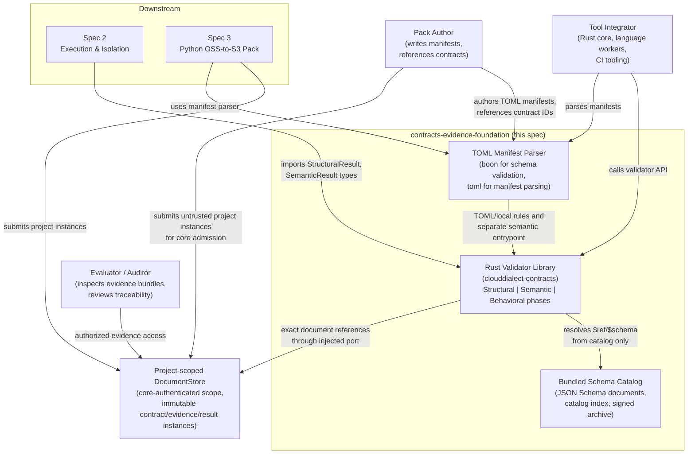
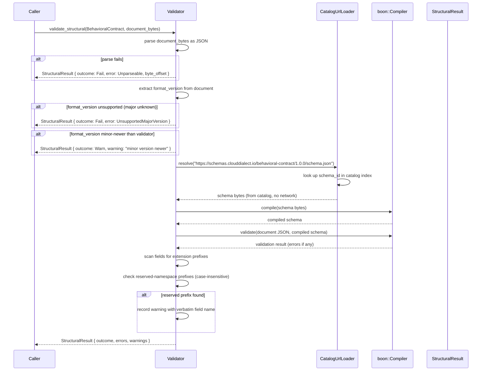
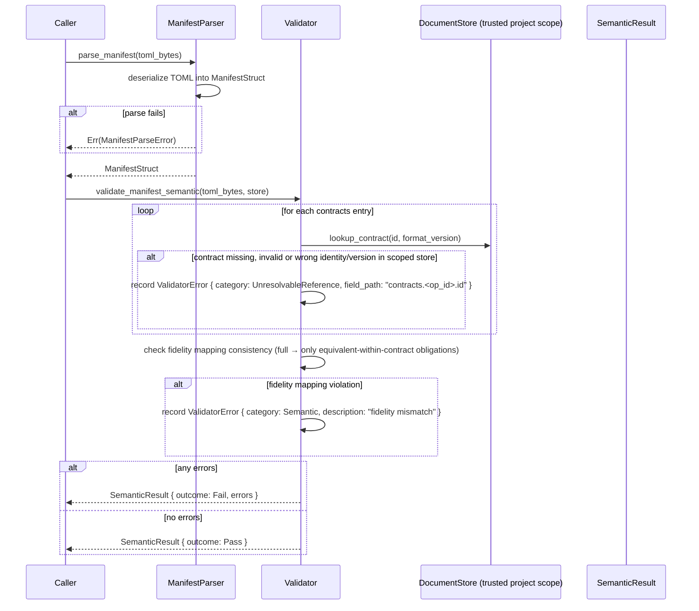
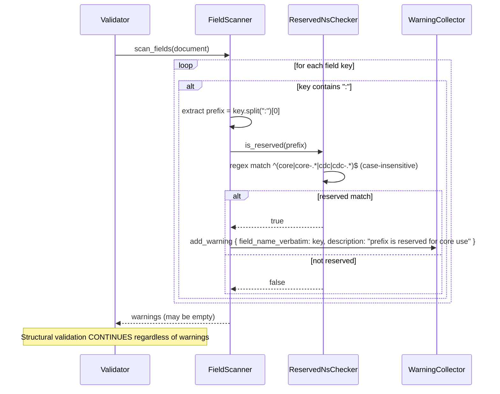

# Design Document

**Later publication action approval:** the user explicitly requested git commit and git push for this work. Those actions are now authorized; the earlier no-commit/no-push implementation limit is historical. Native probes, deployment and releases remain unauthorized.


## Current physical domain layout
User requested domain-first organization on2026-10-22. Document DTO implementation is now private `src/documents/{behavioral_contract,evidence,verification,references,raw_objects}.rs`; `src/validator/mod.rs` preserves every existing public document import as a compatibility facade. Existing `manifest/`, `schema/` and `errors/` remain cohesive domains/support. Historical source paths below describe original task ownership; new edits use the current owner paths. No new public document namespace, aggregate framework, validator behavior or gate approval follows from this move. Shared repository AI guidance is canonical `.agents/rules/engineering.md` with relative client entrypoint symlinks.

## Feature: contracts-evidence-foundation

---

## Overview

**Current continuation status (2026-10-22):** user approved P0-A–F for implementation planning, then separately authorized the remaining Spec 1 prerequisite units in [implementation-plan.md](implementation-plan.md), TDD and no commits/probes/pushes/releases. User attests this is a new project and approves document/catalog **1.0.0** and crate API **0.1.0** as the initial MVP versions. This is not an independent external-publication audit or security-gate approval. Exact encoded extension JSON value bytes are required; raw_value on the existing pinned serde_json is separately approved.

**Delivery is partial.** DTOs, schemas, catalog inventory, frozen snapshot/loading, structural JSON validation, local TOML rules and candidate hash equality have bounded verification. JSON semantic/completeness validation, full mandatory-blocker integration, exhaustive conformance and delivered downstream compatibility remain unfinished; scoped fidelity/TOML semantic delivery is recorded in the current report. See the [current run report](../../../.workflow/ultracode/execution-isolation-implementation/final-report.md) for actual evidence and outstanding work. Canonical task checkmarks are conservative; BG-01 and Spec 2 UD-1–UD-5 remain OPEN.

This design document specifies the technical architecture for the CloudDialect **Contracts & Evidence Foundation** — Spec 1 of 3 in a sequenced set.

**What this spec produces:**

- Five application JSON Schema Draft 2020-12 documents: behavioral contract, evidence record, verification result, catalog index and extension registry; no manifest JSON Schema.
- A TOML 1.0 manifest schema for transformation packs.
- A Bundled Schema Catalog with offline resolution, versioned path layout, and release-artifact signing.
- A Rust validator library (`clouddialect-contracts`) implementing three distinct validation phases with a clean public API.
- A conformance fixture suite that exercises all schema documents across positive, negative, adversarial, and round-trip test cases.
- A compatibility policy and extension convention document.

**What downstream specs depend on this spec:**

- **Spec 2 (Execution & Isolation)** — depends on behavioral contract schema, evidence record schema, and the validator library's `StructuralResult` and `SemanticResult` types.
- **Spec 3 (Python OSS-to-S3 Migration Pack)** — depends on pack manifest schema, behavioral contract schema, evidence record schema, and verification result schema.

**What this spec explicitly does not produce:**

- Rust CLI implementation or command-line interface.
- Worker isolation and execution environment.
- Python OSS-to-S3 transformation logic.
- Production data transfer, traffic cutover, or source-resource deletion.
- Commercial service delivery.
- Performance benchmarks or SLA thresholds.

---

## Architecture

CloudDialect Contracts & Evidence Foundation consists of four layers:

1. **Schema layer** — five application JSON Schema Draft 2020-12 documents (behavioral contract, evidence record, verification result, catalog index, extension registry), plus admitted resolver support material, bundled and signed at release time.
2. **Manifest layer** — a TOML 1.0 pack manifest format parsed and structurally validated by the Rust manifest parser using `toml` + programmatic rules.
3. **Validator library layer** — the `clouddialect-contracts` Rust crate exposing three non-interchangeable validation phases (structural, semantic, behavioral) with an offline-only `CatalogUrlLoader` backed by `boon`.
4. **Conformance fixture layer** — a directory-per-fixture test suite executed by `cargo test --test conformance`, verifying all three implementations (Rust, and future language workers) agree on schema interpretation.

Schema resolution uses embedded or explicitly supplied immutable snapshots, never a live filesystem overlay or network. Semantic references come from an explicitly injected project-scoped DocumentStore; Spec 1 does not choose that store's backend or authority.

---

## Components and Interfaces

### Primary components

| Component | Language | Crate/File | Public interface |
|---|---|---|---|
| Bundled Schema Catalog | JSON / TOML | `catalog/` directory | Resolved via `CatalogUrlLoader`; index at `catalog/index.json` |
| `CatalogUrlLoader` | Rust | `clouddialect-contracts/src/schema/loader.rs` | Implements `boon::UrlLoader` |
| `Validator` | Rust | `clouddialect-contracts/src/validator/` | `validate_structural()`, `validate_semantic()` |
| `ManifestValidator` | Rust | `clouddialect-contracts/src/manifest/` | `validate_manifest()` |
| Conformance Fixture Suite | JSON | `fixtures/` | `cargo test --test conformance` |

### Interface contracts

- `CatalogUrlLoader` resolves exact URIs against an explicit immutable CatalogSnapshot, never ambient environment or network. Read-only checksum-matched boon source verifies the adapter signature below; behavior/qualification remains UNVERIFIED. Public callers supply admitted bytes, not arbitrary loaders.
- `Validator::validate_structural()` returns `StructuralResult` only. It has no API surface for semantic or behavioral claims.
- `Validator::validate_semantic(kind, document, store)` returns SemanticResult for JSON after structural checks. DocumentKind is trusted caller purpose, not an inferred input shape. `ManifestValidator::validate_manifest_semantic(toml_bytes, store)` checks TOML references/fidelity through the same project-scoped DocumentStore, not the schema catalog.
- `ManifestValidator::validate_manifest()` returns ManifestValidationResult with structural_errors, semantic_errors (local-rule failures) and warnings; it does not establish external reference integrity. Fidelity/reference failures are returned by validate_manifest_semantic as ValidatorError entries.
- All result types are `non-interchangeable`: no `From`/`Into` between `StructuralResult`, `SemanticResult`, and `BehavioralResult`.

---

## System Context



---

## Component Architecture

### 3.1 Bundled Schema Catalog

The catalog is the sole trusted source for schema resolution. No outbound network requests are permitted during validation.

**Directory layout:**

```
catalog/
  index.json                        ← self-validating catalog index
  extension-registry.json           ← community extension namespace registry (may be empty at initial release)
  schemas/
    behavioral-contract/
      1.0/
        schema.json
    evidence-record/
      1.0/
        schema.json
    verification-result/
      1.0/
        schema.json
    catalog-index/
      1.0/
        schema.json
    extension-registry/
      1.0/
        schema.json
```

**Path pattern:** `schemas/{document-type}/{major}.{minor}/schema.json`  
All `major` and `minor` components are integers. Patch corrections do not introduce new path entries; they update the file in place within the same `{major}.{minor}` directory and increment the `$id` URI's patch component.

When a new document-format MAJOR version is published, the prior version's directory is retained for the duration of the 12-month minimum support window (Requirement 7.1). Each retained directory is annotated in `index.json` with its end-of-life date once declared.

**Catalog index document (`index.json`):**

The index maps schema identifiers to catalog-relative paths. It is itself schema-valid against `schemas/catalog-index/1.0/schema.json`. See Section 4.5 for the index data model.

**Provenance signing:**

Every release archive of the catalog directory is signed with an asymmetric key using the scheme described in Section 3.5 of the distribution mechanism decision (UD-5). The signing key's public half is committed to the CloudDialect repository. Consumers verify the signature offline against the published public key without contacting any third-party service. Signing covers the catalog archive as a whole; it does not sign individual schema files independently. If a consumer unpacks and modifies an individual file, the archive-level signature is invalidated.

### 3.2 JSON Schema Documents

**`$id` URI structure:**

All CloudDialect JSON Schema `$id` URIs follow the pattern:

```
https://schemas.clouddialect.io/{document-type}/{major}.{minor}.{patch}/schema.json
```

This URI is an identifier only; it is not fetched at runtime. All resolution is performed against the Bundled Schema Catalog using the catalog index. The URI namespace is `schemas.clouddialect.io`.

**Extension mechanism — `unevaluatedProperties` vs `additionalProperties`:**

`additionalProperties` applies only to properties not covered by the *current* schema's `properties` and `patternProperties`. It does not account for properties that are valid under a `$ref` or `allOf` sub-schema. This creates a problem: if a future sub-schema adds fields that compose with the base schema, `additionalProperties: false` would reject them. More importantly, `additionalProperties` cannot distinguish between a community extension field with a namespaced key (e.g., `acme:custom`) and a plain unknown field.

`unevaluatedProperties` (a Draft 2020-12 keyword) applies to all properties not evaluated by *any* applied schema, including `allOf`, `$ref`, and `if`/`then`. This is the correct keyword for composable schemas.

However, CloudDialect's extension fields use a qualified key format (`prefix:name`). A `patternProperties` entry keyed on `^[a-zA-Z][a-zA-Z0-9-]+:` matches all valid community extension keys and allows them without triggering `unevaluatedProperties`. The design uses:

```json
"patternProperties": {
  "^[a-zA-Z][a-zA-Z0-9\\-]+:": {}
},
"unevaluatedProperties": false
```

This accepts any field with a qualifying extension prefix and rejects any other unrecognized field. Reserved-prefix detection is a runtime concern in the validator (see Section 3.4), not a JSON Schema concern — JSON Schema cannot perform case-insensitive string matching in Draft 2020-12 without `format` keywords, which are advisory.

**Traceability:** Requirement 2.6, 3.5, 4.5, 10.2, 10.3.

### 3.3 TOML Manifest Structure

The pack manifest is a human-authored TOML 1.0 file. Its structure:

```toml
[pack]
id          = "io.clouddialect.python.oss-to-s3"
version     = "0.1.0"
name        = "Python Alibaba OSS to AWS S3"
description = "Transforms Python Alibaba OSS SDK usage to AWS S3 boto3."

[source]
cloud    = "alibaba"
service  = "oss"
language = "python"
language_version_range = ">=3.8,<4.0"

[target]
cloud   = "aws"
service = "s3"

[schema_refs]
contract_schema_version           = "1.0.0"
evidence_record_schema_version    = "1.0.0"
verification_result_schema_version = "1.0.0"

[compatibility]
catalog_min = "1.0.0"
catalog_max = "1.0.0"

[capabilities]
format_version = "1.0.0"
[[capabilities.requirements]]
id = "write-test-store"
operation_id = "upload_object"
action = "write"
resource = "test-object-store"
purpose = "behavioral-test"

[[operations]]
id                  = "upload_object"
behavioral_fidelity = "full"
assumptions         = ["bucket exists and is accessible"]
limitations         = []

[[operations]]
id                  = "generate_presigned_url"
behavioral_fidelity = "partial"
assumptions         = []
limitations         = ["expiry precision differs: OSS supports milliseconds, S3 supports seconds"]

[[toolchain]]
name            = "boto3"
version_range   = ">=1.28.0"

[contracts]
[contracts.upload_object]
id             = "cef-contract-upload-001"
format_version = "1.0.0"

[x]
# Community extension fields under the [x] table
```

**Manifest validation rules enforced by the Rust manifest validator:**

1. `[pack].id` must match the dot-separated reverse-domain-name grammar. Traceability: Requirement 5.1.
2. `[pack].version`, `[compatibility].catalog_min`, `[compatibility].catalog_max` must be SemVer 2.0.0. Traceability: Requirement 5.1, 5.4.
3. Each `[[operations]]` entry's `behavioral_fidelity` must be one of `full` / `partial` / `unsupported`. Traceability: Requirement 5.2.
4. Each `[contracts.*]` entry must carry `id` and `format_version` and must NOT include the body of the contract document. Traceability: Requirement 5.3.
5. If any `[[operations]]` entry declares `behavioral_fidelity` as `full` or `partial`, the `[[toolchain]]` array must be present and non-empty. Traceability: Requirement 5.5.
6. `[x]` fields are accepted and preserved; they must not conflict with top-level core keys. Traceability: Requirement 5.6.
7. An operation with `behavioral_fidelity = "unsupported"` is retained in the parsed operation list and returned through the same listing interface as other operations. Traceability: Requirement 5.7.
8. `[capabilities]` is required and follows P0-B: explicit supported format_version and typed requirements (explicit empty array allowed), exact fields/closed actions/unique IDs/known operation_id. Declarations describe needs only; unknown resource resolution or prohibited worker authority is denied by Spec 2 admission. `[x]` never grants or overrides a capability. Traceability: Requirement 5.8.

**Fidelity enum mapping (UD gap resolved in Section 4.6):** Manifest `full` / `partial` / `unsupported` are a summary view. The authoritative per-obligation fidelity is in the referenced behavioral contract document using the full five-value enum.

### 3.4 Rust Validator Library

The library is organized as a single crate (`clouddialect-contracts`) with the module structure described in Section 10.

**Three result types:**

Each validation phase returns a distinct, non-interchangeable type:

```rust
/// Phase 1: JSON Schema structural validation
pub struct StructuralResult {
    pub document_id: Option<String>,
    pub format_version: Option<String>,
    pub outcome: StructuralOutcome,
    pub errors: Vec<ValidatorError>,
    pub warnings: Vec<ValidatorWarning>,
}

/// Phase 2: Reference integrity (contract refs, evidence refs)
pub struct SemanticResult {
    pub document_id: Option<String>,
    pub outcome: SemanticOutcome,
    pub errors: Vec<ValidatorError>,
}

/// Phase 3: Behavioral verification (independently controlled tests)
pub struct BehavioralResult {
    pub candidate_id: String,
    pub outcome: BehavioralOutcome,
    pub verification_result: Option<DocumentRef>,
    pub test_results: Vec<TestResult>,
    pub blocking_gaps: Vec<BlockingGap>,
}
```

`StructuralResult` has no field implying semantic or behavioral correctness. `SemanticResult` has no field implying behavioral correctness. These types are not interchangeable and have no `From` / `Into` implementations between them. Traceability: Requirement 8.1, 8.2.

P0-A defines BehavioralOutcome exactly as Deferred/EvidenceComplete/Blocked; all are non-accepting. Spec 1 completeness returns no verification reference and an empty test projection. Spec 2 may attach the exact validated verification document/test projection, but authentication, protected obligations, fresh approvals and durable acceptance remain separate checks. See P0-A/C/E for TestResult, FailureDescription, DocumentRef, verification projection and DocumentStore contracts; these are proposed types, not exports.

**Offline resolver injection:**

Proposed CatalogUrlLoader behavior (boon 0.6.1 trait/injection signatures source-verified during planning; implementation and runtime behavior remain UNVERIFIED):

1. Owns a frozen embedded or explicitly supplied CatalogSnapshot using P0-D constructors/identity encoding.
2. Resolves exact admitted index entries, including required meta-schema/vocabulary material; a URI prefix alone grants nothing.
3. Serves immutable schema material without network, live filesystem or environment-selected lookups.
4. Parses admitted JSON bytes into serde_json::Value for UrlLoader::load, returning boxed errors on missing/invalid resources; map actual engine diagnostics to actionable UnresolvableReference without inventing an execution error category.

The source-verified sequence is Compiler::new(), then use_loader(Box<dyn UrlLoader>) before compilation; load(&self, url: &str) returns Result<serde_json::Value, Box<dyn std::error::Error>>. Format assertions can be enabled explicitly; that does not prove complete date validation or UTC-Z policy. Trusted callers may explicitly supply admitted snapshot bytes; no public network-loader injection. Neither CLOUDDIALECT_CATALOG_DIR nor CLOUDDIALECT_SCHEMA_CATALOG is read by the library. Schema catalog and project-scoped document instance store are separate. Traceability: Requirement 1.2, 1.3, 8.3, 9.1–9.5; P0-D/E. Evidence: checksum-matched source paths/lines in results/planning-boon-api.json under the run directory.

**Reserved-namespace detection:**

At validation time, the validator scans all fields in the document. For each field whose key contains a colon (`:`) separator, it extracts the prefix portion and tests it against the reserved family list case-insensitively.

Implementation uses a compiled regular expression:

```
^(core|core-[a-z0-9-]*|cdc|cdc-[a-z0-9-]*)$  (case-insensitive flag)
```

This regex is compiled once at library initialization and reused for all validations. A DFA-based approach would also be viable, but a compiled regex is simpler to maintain and extend as the reserved family list grows. If the prefix matches, the validator emits a warning (not an error) containing the verbatim field name and the reserved-prefix description. Structural validation still passes. Traceability: Requirement 10.3.

**Mandatory extension blocker:**

All five JSON document kinds permit optional root `required_extensions`: a unique array of decoded ASCII namespace-prefix strings, minimum two characters, letter start, then alphanumeric/hyphen, no colon or whitespace. Omission/empty declares none. This is a core field, explicitly retained by the four existing DTOs; no registry DTO is invented. If a declared prefix has no trusted implemented semantics, the extension validator emits a separate acceptance blocker even when no matching payload exists. Structural success, catalog/registry membership, claimed ownership and optional payload do not establish recognition. MVP currently implements no extension semantics; later activation requires a real trusted implementation, not declaration data. Existing root openness outside this new field is unchanged. Traceability: Requirement10.4, owner-approved EX-1; blocker logic remains the separate validator unit, not schema acceptance.

**Error response structure (Requirement 11):**

```rust
pub struct ValidatorError {
    pub document_id: Option<String>,
    pub format_version: Option<String>,
    pub category: ErrorCategory,
    pub field_path: Option<String>,       // dot-notation
    pub description: String,
    pub byte_offset: Option<usize>,       // present when category == Unparseable
}

pub enum ErrorCategory {
    Structural,
    Semantic,
    Version,
    UnresolvableReference,
    Unparseable,
    UnsupportedVersion,
    UnsupportedMajorVersion,
    Unsupported,        // manifest operation coverage gap
    BlockingGap,        // missing mandatory evidence
}
```

### 3.5 Conformance Fixture Suite

**Directory layout (resolved from UD-4 — see Section 6):**

```
fixtures/
  positive/
    behavioral-contract/
      minimal-valid/
        input.json
        expected.json
      with-inferred-evidence/
        input.json
        expected.json
      ...
    evidence-record/
      ...
    verification-result/
      ...
    pack-manifest/
      ...
  negative/
    behavioral-contract/
      missing-id/
        input.json
        expected.json
      ...
  adversarial/
    extension-namespace/
      reserved-exact-match/
        input.json
        expected.json
      reserved-uppercase-bypass/
        input.json
        expected.json
      ...
  round-trip/
    extension-field-preservation/
      input.json
      expected.json
  integration/
    blocking-gap/
      input.json
      expected.json
    semantic-resolution-failure/
      input.json
      expected.json
    artifact-hash-mismatch/
      input.json
      expected.json
```

**Fixture `expected.json` schema:**

```json
{
  "outcome": "phase-specific value (see below)",
  "phase": "structural | semantic | behavioral | artifact-hash",
  "document_kind": "explicit JSON DocumentKind, or manifest for TOML",
  "errors": [
    {
      "category": "<ErrorCategory>",
      "field_path": "<dot-notation or null>",
      "description_contains": "<substring that must appear in the description>"
    }
  ],
  "warnings": [
    {
      "field_name_verbatim": "<exact field name>",
      "description_contains": "<substring>"
    }
  ],
  "blockers": [
    {
      "obligation_id": "<id>",
      "assumption_text_contains": "<substring>"
    }
  ]
}
```

P0-E expectation union: structural uses pass/warn/fail; semantic uses pass/fail; behavioral completeness uses deferred/evidence-complete/blocked exactly, never pass/fail normalization. Artifact-hash fixtures omit outcome and require expected_match boolean matching verify_artifact_hash. JSON fixtures declare the trusted DocumentKind; manifest selects TOML. Unsupported phase/outcome pairs and deliberately wrong expectations must fail the runner. Descriptions use substring checks; categories and phase-specific values use exact checks. No runner pass implies behavioral acceptance.

**CI integration:** The fixture suite runs as a Cargo test (`cargo test --test conformance`) that walks the `fixtures/` directory, loads each `input.json` + `expected.json` pair, runs the appropriate validator phase, and asserts the actual output matches the expectation. Traceability: all requirements marked "Conformance fixture" as their verification method.

---

## Data Models

### 4.1 Behavioral Contract

**Owner-approved RC-1 resource binding (2026-10-22):** resource-specific assumptions carry `behavior: ordering | consistency | retry | failure` plus nonempty `assumption_id`, `description`, `reason`. For every dependency, each dimension has a nonempty known declaration or a matching populated assumption; both are permitted for partial knowledge. Generic evidence/obligation assumptions keep their existing shape. DTOs use distinct `ResourceBehaviorDimension` and `ResourceUnresolvedAssumption` types, retain exact extension-value bytes, and do not perform schema completeness checks. This is an intentional approved initial-MVP resource-model/API amendment, not a backward-compatible reinterpretation or behavioral evidence. The matching schema block is reconciled in the schema implementation leaf.

Annotated JSON Schema skeleton (key fields with types and constraints):

```json
{
  "$schema": "https://json-schema.org/draft/2020-12/schema",
  "$id": "https://schemas.clouddialect.io/behavioral-contract/1.0.0/schema.json",
  "type": "object",
  "required": [
    "id", "format_version", "operation_identity",
    "inputs", "outputs", "side_effects",
    "resource_dependencies", "obligations"
  ],
  "properties": {
    "required_extensions": {
      "type": "array",
      "uniqueItems": true,
      "items": {
        "type": "string",
        "pattern": "^[A-Za-z][A-Za-z0-9-]+$",
        "not": {"pattern": "\\s"}
      }
    },
    "$schema": { "type": "string", "minLength": 1 },
    "id": {
      "type": "string",
      "format": "uuid",
      "description": "UUID v4, hyphenated lowercase. Unique within the pack."
    },
    "format_version": {
      "type": "string",
      "pattern": "^(0|[1-9][0-9]*)\\.(0|[1-9][0-9]*)\\.(0|[1-9][0-9]*)(?:-(?:0|[1-9][0-9]*|[0-9]*[A-Za-z-][0-9A-Za-z-]*)(?:\\.(?:0|[1-9][0-9]*|[0-9]*[A-Za-z-][0-9A-Za-z-]*))*)?(?:\\+[0-9A-Za-z-]+(?:\\.[0-9A-Za-z-]+)*)?$(?![\\s\\S])",
      "description": "Document-format version (SemVer 2.0.0). Distinct from pack version and JSON Schema dialect version."
    },
    "operation_identity": {
      "type": "object",
      "required": ["call_site"],
      "properties": {
        "call_site": {
          "type": "string",
          "description": "Fully qualified identifier of the operation entry point."
        },
        "wrapper_chain": {
          "type": "array",
          "minItems": 1,
          "items": { "type": "string" },
          "description": "Ordered list of wrappers in the call chain up to the operation boundary. Required to be non-empty when a wrapper chain exists."
        }
      }
    },
    "inputs": {
      "type": "object",
      "description": "JSON Schema fragment describing the operation's input structure."
    },
    "outputs": {
      "type": "object",
      "description": "JSON Schema fragment describing the operation's output structure."
    },
    "side_effects": {
      "type": "array",
      "items": {
        "type": "object",
        "required": ["description"],
        "properties": {
          "description": { "type": "string" },
          "evidence_ref": { "type": "string", "description": "Reference to an evidence record id." }
        }
      },
      "description": "Externally visible side effects."
    },
    "resource_dependencies": {
      "type": "array",
      "items": {
        "type": "object",
        "required": ["identity", "permissions", "configuration"],
        "properties": {
          "identity": { "type": "string" },
          "permissions": {
            "type": "array",
            "items": { "type": "string" }
          },
          "configuration": { "type": "object" },
          "known_behavior": {
            "type": "object",
            "properties": {
              "ordering": { "type": "string", "minLength": 1 },
              "consistency": { "type": "string", "minLength": 1 },
              "retry": { "type": "string", "minLength": 1 },
              "failure": { "type": "string", "minLength": 1 }
            }
          },
          "unresolved_assumptions": {
            "type": "array",
            "items": { "$ref": "#/$defs/resource_unresolved_assumption" }
          }
        },
        "allOf": [
          {
            "anyOf": [
              {
                "required": ["known_behavior"],
                "properties": {"known_behavior": {"required": ["ordering"]}}
              },
              {
                "required": ["unresolved_assumptions"],
                "properties": {"unresolved_assumptions": {"contains": {"required": ["behavior"], "properties": {"behavior": {"const": "ordering"}}}}}
              }
            ]
          },
          {
            "anyOf": [
              {
                "required": ["known_behavior"],
                "properties": {"known_behavior": {"required": ["consistency"]}}
              },
              {
                "required": ["unresolved_assumptions"],
                "properties": {"unresolved_assumptions": {"contains": {"required": ["behavior"], "properties": {"behavior": {"const": "consistency"}}}}}
              }
            ]
          },
          {
            "anyOf": [
              {
                "required": ["known_behavior"],
                "properties": {"known_behavior": {"required": ["retry"]}}
              },
              {
                "required": ["unresolved_assumptions"],
                "properties": {"unresolved_assumptions": {"contains": {"required": ["behavior"], "properties": {"behavior": {"const": "retry"}}}}}
              }
            ]
          },
          {
            "anyOf": [
              {
                "required": ["known_behavior"],
                "properties": {"known_behavior": {"required": ["failure"]}}
              },
              {
                "required": ["unresolved_assumptions"],
                "properties": {"unresolved_assumptions": {"contains": {"required": ["behavior"], "properties": {"behavior": {"const": "failure"}}}}}
              }
            ]
          }
        ]
      }
    },
    "obligations": {
      "type": "array",
      "items": {
        "type": "object",
        "required": ["obligation_id", "behavioral_fidelity"],
        "oneOf": [
          {
            "required": ["evidence_refs"],
            "properties": {
              "evidence_refs": {
                "type": "array",
                "minItems": 1,
                "items": { "type": "string" }
              }
            }
          },
          {
            "required": ["unresolved_assumption"],
            "properties": {
              "unresolved_assumption": { "$ref": "#/$defs/unresolved_assumption" }
            }
          }
        ],
        "properties": {
          "obligation_id": { "type": "string" },
          "behavioral_fidelity": {
            "type": "string",
            "enum": [
              "equivalent-within-contract",
              "adaptation-required",
              "architectural-change-required",
              "unsupported",
              "unknown"
            ]
          }
        }
      }
    },
    "behavioral_notes": {
      "type": "array",
      "items": {
        "type": "object",
        "required": ["note_type", "description", "evidence_ref"],
        "properties": {
          "note_type": { "type": "string" },
          "description": { "type": "string" },
          "evidence_ref": { "type": "string" }
        }
      }
    }
  },
  "patternProperties": {
    "^[a-zA-Z][a-zA-Z0-9\\-]+:": {}
  },
  "unevaluatedProperties": false,
  "$defs": {
    "resource_unresolved_assumption": {
      "$ref": "#/$defs/unresolved_assumption",
      "required": ["behavior"],
      "properties": {
        "behavior": {
          "type": "string",
          "enum": ["ordering", "consistency", "retry", "failure"]
        },
        "assumption_id": {"minLength": 1},
        "description": {"minLength": 1},
        "reason": {"minLength": 1}
      }
    },
    "unresolved_assumption": {
      "type": "object",
      "required": ["assumption_id", "description", "reason"],
      "properties": {
        "assumption_id": { "type": "string" },
        "description": { "type": "string" },
        "reason": { "type": "string" }
      }
    }
  }
}
```

**Traceability:** Requirement 2.1, 2.2, 2.3, 2.4, 2.5, 2.6.

### 4.2 Evidence Record

```json
{
  "$schema": "https://json-schema.org/draft/2020-12/schema",
  "$id": "https://schemas.clouddialect.io/evidence-record/1.0.0/schema.json",
  "type": "object",
  "required": ["id", "format_version", "claim", "classification"],
  "properties": {
    "required_extensions": {
      "type": "array",
      "uniqueItems": true,
      "items": {
        "type": "string",
        "pattern": "^[A-Za-z][A-Za-z0-9-]+$",
        "not": {"pattern": "\\s"}
      }
    },
    "$schema": { "type": "string", "minLength": 1 },
    "id": {
      "type": "string",
      "format": "uuid",
      "description": "UUID v4, hyphenated lowercase."
    },
    "format_version": {
      "type": "string",
      "pattern": "^(0|[1-9][0-9]*)\\.(0|[1-9][0-9]*)\\.(0|[1-9][0-9]*)(?:-(?:0|[1-9][0-9]*|[0-9]*[A-Za-z-][0-9A-Za-z-]*)(?:\\.(?:0|[1-9][0-9]*|[0-9]*[A-Za-z-][0-9A-Za-z-]*))*)?(?:\\+[0-9A-Za-z-]+(?:\\.[0-9A-Za-z-]+)*)?$(?![\\s\\S])"
    },
    "claim": { "type": "string" },
    "classification": {
      "type": "string",
      "enum": ["observed", "inferred", "unknown"]
    },
    "unresolved_assumptions": {
      "type": "array",
      "items": {
        "type": "object",
        "required": ["assumption_id", "description", "reason"],
        "properties": {
          "assumption_id": { "type": "string" },
          "description": { "type": "string" },
          "reason": { "type": "string" }
        }
      }
    }
  },
  "if": {
    "properties": { "classification": { "const": "observed" } }
  },
  "then": {
    "required": ["provenance"],
    "properties": {
      "provenance": {
        "type": "object",
        "required": ["source_artifact_identity", "analysis_tool_identity"],
        "properties": {
          "source_artifact_identity": { "type": "string" },
          "analysis_tool_identity": { "type": "string" }
        }
      }
    }
  },
  "else": {
    "if": {
      "properties": { "classification": { "const": "inferred" } }
    },
    "then": {
      "required": ["reasoning_chain"],
      "properties": {
        "reasoning_chain": {
          "type": "array",
          "minItems": 1,
          "items": { "type": "string" }
        }
      }
    },
    "else": {
      "required": ["unresolved_assumptions"],
      "properties": {
        "unresolved_assumptions": {
          "minItems": 1
        }
      }
    }
  },
  "patternProperties": {
    "^[a-zA-Z][a-zA-Z0-9\\-]+:": {}
  },
  "unevaluatedProperties": false
}
```

**Traceability:** Requirement 3.1, 3.2, 3.3, 3.4, 3.5.

### 4.3 Verification Result

**P0-C initial MVP schema artifact implemented under separate code/version approvals; semantic and authority checks remain unfinished.** Configuration is a reference to exact immutable secret-free bytes. Artifact bindings and approval/origin strings are untrusted claims until checked against independent trusted context; JSON Schema cannot authenticate them. P0-C specifies semantic checks for digest lengths, unique test IDs, obligation membership, UTC time and matching document references.

```json
{
  "$schema": "https://json-schema.org/draft/2020-12/schema",
  "$id": "https://schemas.clouddialect.io/verification-result/1.0.0/schema.json",
  "type": "object",
  "required": [
    "id",
    "format_version",
    "candidate",
    "pack",
    "toolchain",
    "configuration",
    "binding",
    "tests"
  ],
  "properties": {
    "required_extensions": {
      "type": "array",
      "uniqueItems": true,
      "items": {
        "type": "string",
        "pattern": "^[A-Za-z][A-Za-z0-9-]+$",
        "not": {"pattern": "\\s"}
      }
    },
    "$schema": { "type": "string", "minLength": 1 },
    "id": {
      "type": "string",
      "format": "uuid"
    },
    "format_version": {
      "type": "string",
      "pattern": "^(0|[1-9][0-9]*)\\.(0|[1-9][0-9]*)\\.(0|[1-9][0-9]*)(?:-(?:0|[1-9][0-9]*|[0-9]*[A-Za-z-][0-9A-Za-z-]*)(?:\\.(?:0|[1-9][0-9]*|[0-9]*[A-Za-z-][0-9A-Za-z-]*))*)?(?:\\+[0-9A-Za-z-]+(?:\\.[0-9A-Za-z-]+)*)?$(?![\\s\\S])"
    },
    "candidate": {
      "$ref": "#/$defs/artifact_ref"
    },
    "pack": {
      "$ref": "#/$defs/versioned_artifact"
    },
    "toolchain": {
      "$ref": "#/$defs/versioned_artifact"
    },
    "configuration": {
      "$ref": "#/$defs/artifact_ref"
    },
    "binding": {
      "$ref": "#/$defs/verification_binding"
    },
    "tests": {
      "type": "array",
      "minItems": 1,
      "items": {
        "type": "object",
        "required": [
          "test_id",
          "obligation_ids",
          "outcome",
          "origin_identity"
        ],
        "properties": {
          "test_id": {
            "type": "string",
            "minLength": 1
          },
          "obligation_ids": {
            "type": "array",
            "minItems": 1,
            "uniqueItems": true,
            "items": {
              "type": "string",
              "minLength": 1
            }
          },
          "outcome": {
            "type": "string",
            "enum": [
              "pass",
              "fail",
              "skip",
              "error"
            ]
          },
          "origin_identity": {
            "type": "string",
            "minLength": 1
          },
          "failure_description": {
            "$ref": "#/$defs/failure"
          }
        },
        "unevaluatedProperties": false,
        "if": {
          "properties": {
            "outcome": {
              "enum": [
                "fail",
                "skip",
                "error"
              ]
            }
          },
          "required": [
            "outcome"
          ]
        },
        "then": {
          "required": [
            "failure_description"
          ]
        }
      }
    },
    "acceptance": {
      "type": "object",
      "required": [
        "approver_identities",
        "timestamp",
        "verification_result",
        "approval_evidence"
      ],
      "properties": {
        "approver_identities": {
          "type": "array",
          "minItems": 1,
          "uniqueItems": true,
          "items": {
            "type": "string",
            "minLength": 1
          }
        },
        "timestamp": {
          "type": "string",
          "format": "date-time",
          "pattern": "Z$"
        },
        "verification_result": {
          "$ref": "#/$defs/document_ref"
        },
        "approval_evidence": {
          "$ref": "#/$defs/artifact_ref"
        }
      },
      "unevaluatedProperties": false
    }
  },
  "unevaluatedProperties": false,
  "$defs": {
    "content_hash": {
      "type": "object",
      "required": [
        "algorithm",
        "value"
      ],
      "properties": {
        "algorithm": {
          "type": "string",
          "enum": [
            "sha-256",
            "sha-384",
            "sha-512",
            "sha3-256",
            "sha3-512"
          ]
        },
        "value": {
          "type": "string",
          "pattern": "^[0-9a-f]+$"
        }
      },
      "unevaluatedProperties": false
    },
    "artifact_ref": {
      "type": "object",
      "required": [
        "identity",
        "content_hash"
      ],
      "properties": {
        "identity": {
          "type": "string",
          "minLength": 1
        },
        "content_hash": {
          "$ref": "#/$defs/content_hash"
        }
      },
      "unevaluatedProperties": false
    },
    "versioned_artifact": {
      "type": "object",
      "required": [
        "id",
        "version",
        "content_hash"
      ],
      "properties": {
        "id": {
          "type": "string",
          "minLength": 1
        },
        "version": {
          "type": "string",
          "pattern": "^(0|[1-9][0-9]*)\\.(0|[1-9][0-9]*)\\.(0|[1-9][0-9]*)(?:-(?:0|[1-9][0-9]*|[0-9]*[A-Za-z-][0-9A-Za-z-]*)(?:\\.(?:0|[1-9][0-9]*|[0-9]*[A-Za-z-][0-9A-Za-z-]*))*)?(?:\\+[0-9A-Za-z-]+(?:\\.[0-9A-Za-z-]+)*)?$(?![\\s\\S])"
        },
        "content_hash": {
          "$ref": "#/$defs/content_hash"
        }
      },
      "unevaluatedProperties": false
    },
    "document_ref": {
      "type": "object",
      "required": [
        "id",
        "format_version"
      ],
      "properties": {
        "id": {
          "type": "string",
          "minLength": 1
        },
        "format_version": {
          "type": "string",
          "pattern": "^(0|[1-9][0-9]*)\\.(0|[1-9][0-9]*)\\.(0|[1-9][0-9]*)(?:-(?:0|[1-9][0-9]*|[0-9]*[A-Za-z-][0-9A-Za-z-]*)(?:\\.(?:0|[1-9][0-9]*|[0-9]*[A-Za-z-][0-9A-Za-z-]*))*)?(?:\\+[0-9A-Za-z-]+(?:\\.[0-9A-Za-z-]+)*)?$(?![\\s\\S])"
        }
      },
      "unevaluatedProperties": false
    },
    "failure": {
      "type": "object",
      "required": [
        "detail"
      ],
      "properties": {
        "detail": {
          "type": "string",
          "minLength": 1,
          "maxLength": 2000
        }
      },
      "unevaluatedProperties": false
    },
    "verification_binding": {
      "type": "object",
      "required": [
        "tenant_id",
        "project_id",
        "run_id",
        "attempt_id",
        "input",
        "dependencies",
        "suite",
        "oracle",
        "policy",
        "obligation_ids"
      ],
      "properties": {
        "tenant_id": {
          "type": "string",
          "minLength": 1
        },
        "project_id": {
          "type": "string",
          "minLength": 1
        },
        "run_id": {
          "type": "string",
          "minLength": 1
        },
        "attempt_id": {
          "type": "string",
          "minLength": 1
        },
        "input": {
          "$ref": "#/$defs/artifact_ref"
        },
        "dependencies": {
          "$ref": "#/$defs/artifact_ref"
        },
        "suite": {
          "$ref": "#/$defs/artifact_ref"
        },
        "oracle": {
          "$ref": "#/$defs/artifact_ref"
        },
        "policy": {
          "$ref": "#/$defs/artifact_ref"
        },
        "obligation_ids": {
          "type": "array",
          "minItems": 1,
          "uniqueItems": true,
          "items": {
            "type": "string",
            "minLength": 1
          }
        }
      },
      "unevaluatedProperties": false
    }
  },
  "patternProperties": {
    "^[a-zA-Z][a-zA-Z0-9\\-]+:": {}
  }
}
```

**Traceability:** Requirement 4.1–4.8, 8.6–8.7; P0-A/C/E. Mandatory obligation/test completeness, observation authenticity, current-policy approval and durable acceptance remain Spec 2 checks. Any prior published format needs MAJOR-version review before adopting these required fields or the structured failure_description object.

### 4.4 Pack Manifest (TOML)

The manifest is validated by a TOML-to-struct deserialization step followed by a programmatic validation pass in the Rust validator. There is no external JSON Schema for the TOML manifest; the TOML crate deserializes into typed Rust structs, and validation rules are enforced in code. The following represents the Rust struct layout:

```toml
# Normative TOML structure — all fields listed

[pack]
id      = "<reverse-domain-name string>"          # required
version = "<SemVer 2.0.0>"                        # required
name    = "<string>"                              # required
description = "<string>"                          # required

[source]
cloud                  = "<string>"               # required
service                = "<string>"               # required
language               = "<string>"               # required
language_version_range = "<SemVer 2.0.0 range>"  # required

[target]
cloud   = "<string>"                              # required
service = "<string>"                              # required

[schema_refs]
contract_schema_version            = "<SemVer>"  # required
evidence_record_schema_version     = "<SemVer>"  # required
verification_result_schema_version = "<SemVer>"  # required

[compatibility]
catalog_min = "<SemVer>"                          # required
catalog_max = "<SemVer>"                          # required

[capabilities]
format_version = "1.0.0"                          # required, document-format version
requirements = []                                 # required; or typed array-of-tables per P0-B

[[operations]]
# One entry per supported operation
id                  = "<string>"                  # required
behavioral_fidelity = "full | partial | unsupported"  # required
assumptions         = ["<string>"]                # optional, default []
limitations         = ["<string>"]                # optional, default []

[[toolchain]]
# One entry per toolchain dependency
# Required non-empty if any operation is full or partial
name          = "<string>"                        # required
version_range = "<SemVer 2.0.0 range>"           # required

[contracts]
# Sub-tables keyed by operation_id
[contracts."<operation_id>"]
id             = "<uuid>"                         # required
format_version = "<SemVer>"                       # required
# contract body MUST NOT be included inline

[x]
# Extension fields — any key-value pairs; must not shadow top-level core keys
```

### 4.5 Catalog Index

```json
{
  "$schema": "https://json-schema.org/draft/2020-12/schema",
  "$id": "https://schemas.clouddialect.io/catalog-index/1.0.0/schema.json",
  "type": "object",
  "required": ["format_version", "schemas", "resolver_resources"],
  "properties": {
    "required_extensions": {
      "type": "array",
      "uniqueItems": true,
      "items": {
        "type": "string",
        "pattern": "^[A-Za-z][A-Za-z0-9-]+$",
        "not": {"pattern": "\\s"}
      }
    },
    "$schema": { "type": "string", "minLength": 1 },
    "format_version": {
      "type": "string",
      "pattern": "^(0|[1-9][0-9]*)\\.(0|[1-9][0-9]*)\\.(0|[1-9][0-9]*)(?:-(?:0|[1-9][0-9]*|[0-9]*[A-Za-z-][0-9A-Za-z-]*)(?:\\.(?:0|[1-9][0-9]*|[0-9]*[A-Za-z-][0-9A-Za-z-]*))*)?(?:\\+[0-9A-Za-z-]+(?:\\.[0-9A-Za-z-]+)*)?$(?![\\s\\S])"
    },
    "resolver_resources": {
      "type": "array",
      "items": {
        "type": "object",
        "required": ["schema_id", "catalog_path"],
        "properties": {
          "schema_id": { "type": "string", "minLength": 1 },
          "catalog_path": { "type": "string", "minLength": 1 }
        },
        "unevaluatedProperties": false
      }
    },
    "schemas": {
      "type": "array",
      "minItems": 1,
      "items": {
        "type": "object",
        "required": ["schema_id", "document_type", "format_version", "catalog_path", "status"],
        "properties": {
          "schema_id": {
            "type": "string",
            "description": "The $id URI of the schema document."
          },
          "document_type": {
            "type": "string",
            "enum": [
              "behavioral-contract",
              "evidence-record",
              "verification-result",
              "catalog-index",
              "extension-registry"
            ]
          },
          "format_version": { "type": "string" },
          "catalog_path": {
            "type": "string",
            "description": "Path relative to the catalog root, e.g. schemas/behavioral-contract/1.0/schema.json"
          },
          "status": {
            "type": "string",
            "enum": ["current", "supported", "end-of-life-declared"],
            "description": "current = actively published; supported = within 12-month window; end-of-life-declared = window expiry date set."
          },
          "end_of_life_date": {
            "type": "string",
            "format": "date",
            "description": "ISO 8601 date. Required when status is end-of-life-declared."
          }
        },
        "if": {
          "properties": { "status": { "const": "end-of-life-declared" } }
        },
        "then": {
          "required": ["end_of_life_date"]
        }
      }
    }
  }
}
```

The index validates against its own schema. Application schema entries and P0-D resolver_resources are separate; the latter records meta-schema/vocabulary support without inventing a TOML manifest schema. URI keys across both sets must be unique, paths/material immutable and complete. Empty support entries require verified offline engine built-ins, not an assumed network resolver. Traceability: Requirement 1.6, 9.4–9.5; P0-D.

### 4.6 Fidelity Enum Mapping

This was flagged as an unresolved gap between the manifest's simplified `full`/`partial`/`unsupported` enum and the contract's five-value `behavioral_fidelity` enum.

The two enumerations serve different audiences. The manifest `behavioral_fidelity` is a **pack-level summary** for tool integrators who need to quickly understand coverage without reading every contract. The contract `behavioral_fidelity` is a **per-obligation claim** for verifier implementers and auditors who need precise behavioral tracking.

**Mapping:**

| Manifest value | Meaning | Permitted contract obligation values |
|---|---|---|
| `full` | The pack claims all observable behaviors of the source operation are reproduced at the target within the declared contract scope. | `equivalent-within-contract` only. A manifest declaring `full` for an operation may not reference a contract where any obligation carries `adaptation-required`, `architectural-change-required`, `unsupported`, or `unknown`. The manifest validator enforces this when semantic validation is performed. |
| `partial` | The pack claims most behaviors are reproduced; some require adaptation or have known limitations. | `equivalent-within-contract`, `adaptation-required`. Obligations with `architectural-change-required` or `unsupported` values indicate the operation should be declared `unsupported` at the manifest level. |
| `unsupported` | The pack explicitly does not transform this operation. | Any contract `behavioral_fidelity` value is permitted; the contract primarily documents why the operation is unsupported and what evidence supports that determination. |

**Enforcement:** The Rust manifest validator enforces the mapping only during semantic validation (Phase 2), not structural validation (Phase 1). The JSON Schema for the manifest does not encode the mapping constraint because the constraint crosses document boundaries. Traceability: Requirement 5.2, 2.3.

---

## Key Interactions

### 5.1 Structural Validation of a Behavioral Contract Document



### 5.2 Semantic Validation of a Pack Manifest



### 5.3 Blocking-Gap Report Generation

```mermaid
sequenceDiagram
    participant C as Caller
    participant V as Validator
    participant ER as DocumentStore (trusted project scope)
    participant BG as BlockingGapReport

    C->>V: check_evidence_completeness(contract, candidate_id, store)
    loop for each obligation in contract.obligations
        alt obligation has evidence_refs
            V->>ER: fetch evidence record(s) by id
            ER-->>V: evidence record(s)
            loop for each evidence record
                alt classification == "unknown"
                    V->>V: record BlockingGap { obligation_id, assumption_text }
                end
            end
        else obligation has unresolved_assumption
            V->>V: record BlockingGap { obligation_id, assumption_text }
        end
    end
    alt any blocking gaps
        V-->>C: BehavioralResult { outcome: Blocked, blocking_gaps, candidate_id }
        note over V,C: Transformation CANNOT be promoted to accepted state
    else no gaps
        V-->>C: BehavioralResult { outcome: EvidenceComplete }
        note over V,C: Non-accepting; verification_result=None, test_results=[]
    end
```

### 5.4 Reserved-Namespace Detection During Validation



---

## Decision Record

### DR-1: JSON Schema Tooling for Rust (UD-2)

**Decision:** Use `boon` crate (MIT / Apache-2.0 dual-licensed) as the JSON Schema Draft 2020-12 validation engine.

**Rationale:** The existing design selected boon for Draft 2020-12 and offline resolver customization; the scaffold pins 0.6.1. Initial P0 did not verify its adapter API; subsequent planning inspected the checksum-matched official archive and confirmed load/new/use_loader/format-assertion signatures (see §3.4/P0 evidence). This is source evidence, not conformance/offline behavior or current proof of historical competitor comparisons. Format assertions and actual engine behavior still need a verified supported profile.

**Constraints:** Draft 2020-12 full compliance; offline resolver injection; MIT or Apache-2.0 license; active maintenance.

**Alternatives considered:**
- `jsonschema` (Stranger6667): This crate is also actively maintained and fast, but its Draft 2020-12 support is partial — specifically, the `unevaluatedProperties` keyword within composed schemas has known gaps (tracked in issue #195). It uses a custom retriever mechanism but does not guarantee the same Draft 2020-12 coverage as `boon`.
- `jsonschema-valid` (mdboom): Supports only up to Draft 7. Ruled out.
- `valico`: Last significant update 2019. Outdated and unsupported. Ruled out.

**Remaining risk:** `boon` is a smaller community project than `jsonschema`. If it becomes unmaintained, a migration to a successor crate is required. Mitigation: the `CatalogUrlLoader` and validation interface are isolated behind the `clouddialect-contracts` crate's internal module boundary, so a crate swap does not require changes to the public API. Pin the exact version in `Cargo.toml`.

---

### DR-2: TOML Parsing Library for Rust (UD-3)

**Decision:** Use `toml` crate (MIT / Apache-2.0 dual-licensed) for TOML 1.0 manifest parsing.

**Rationale:** The `toml` crate is the de facto standard for TOML parsing in Rust and is used by Cargo itself. It supports TOML 1.0, `serde` integration for struct deserialization, and is MIT / Apache-2.0 dual-licensed. For CloudDialect manifests, the primary need is deserializing a manifest into typed Rust structs — round-trip formatting preservation is not required. The `toml` crate's parse-then-deserialize model fits this use case cleanly and at lower complexity than `toml_edit`.

**Constraints:** TOML 1.0 compliance; serde integration; MIT or Apache-2.0 license; active maintenance.

**Alternatives considered:**
- `toml_edit`: Lossless parser that preserves comments and whitespace. The author of `toml_edit` explicitly recommends using `toml` for serde-driven deserialization and `toml_edit` for format-preserving editing. Since CloudDialect does not edit manifest files programmatically — it only reads and validates them — `toml_edit`'s complexity and performance overhead are unnecessary.

**Remaining risk:** Minimal. The `toml` crate is part of the `toml-rs` organization and tracks the `toml_edit` parser as its backend since toml v0.6+. No risk of divergence.

---

### DR-3: Conformance Fixture Format (UD-4)

**Decision:** Directory-per-fixture convention with `input.json` (or `input.toml` for manifest fixtures) and `expected.json` using a structured expectation schema.

**Rationale:**

Options evaluated:

1. **JSON-based test vectors (flat array in a single file):** Simple but poor discoverability — adding a fixture requires editing a shared file, causing merge conflicts. Hard to run a single fixture in isolation.

2. **YAML-based test suites (JSON Schema Test Suite style):** Human-readable but introduces a YAML parser dependency not needed elsewhere. The JSON Schema Test Suite uses this format for its own test cases, which are different from CloudDialect's multi-phase validation concerns.

3. **Directory-per-fixture with `input.json` + `expected.json`:** Each fixture is a self-contained directory. A contributor can add a fixture by creating a new directory and two files. The test runner discovers fixtures by walking the directory tree. Individual fixtures can be run by specifying the directory path. Portable across Rust and any future language worker that can read files and parse JSON.

4. **Custom format:** Unnecessary complexity without clear benefit.

The directory-per-fixture approach wins on discoverability, isolation, portability, and contributor ergonomics. The `expected.json` schema (specified in Section 3.5) is precise enough to support automation while flexible enough not to require exact string matches in error descriptions.

**Constraints:** Human-readable/writable; machine-executable; covers positive, negative, adversarial, and round-trip cases; portable across language workers.

**Alternatives considered:** See above.

**Remaining risk:** The `expected.json` substring matching approach could allow a fixture to pass with an incorrect but coincidentally matching error message. Mitigation: the `category` field uses exact enum matching; only `description_contains` uses substrings. This is an acceptable trade-off to avoid fixture brittleness from minor wording changes.

---

### DR-4: Schema Registry Distribution Mechanism (UD-5)

**P0 proposed amendment — pending owner approval:** Embedded immutable snapshot by default (include_dir per task 8), or explicit frozen parts supplied by trusted caller after admission. No ambient environment-selected filesystem overlay.

**Rationale:**

Options evaluated:

1. **Directory on disk alongside binary:** Requires the catalog to be present at a well-known relative path at runtime. Breaks if the binary is moved or the catalog directory is absent. Not suitable as the sole mechanism for CLI distribution.

2. **Embedded in binary via `include_bytes!`:** The catalog files are compiled into the binary. Offline resolution works without any filesystem assumption. The binary is self-contained. The `CatalogUrlLoader` uses the embedded bytes as its primary source. This is the correct default for production use.

3. **Separate downloadable archive with checksum:** Requires a download step before use. Breaks offline-first requirement for air-gapped environments.

4. **Explicit snapshot override:** Trusted host code may admit and freeze an approved directory into CatalogSnapshot::from_parts; neither CLOUDDIALECT_CATALOG_DIR nor CLOUDDIALECT_SCHEMA_CATALOG is read by the library. Worker environment/repository content cannot select trust. This replaces the former implicit-overlay proposal; host file acquisition remains outside Spec 1's loader.

The proposed snapshot approach retains embedded/offline/relocatable resolution, with explicit admission and immutable digest comparison. A constructor or digest is not signer-policy evidence; actual provenance verification and engine qualification remain required. See P0-D for exact constructors/snapshot encoding.

**Constraints:** Offline resolution without runtime filesystem assumption; verifiable; catalog-index-driven (no hard-coded paths); practical for CLI and library.

**Alternatives considered:** See above.

**Remaining risk:** Embedding large schema files increases binary size. At the initial schema count (five schemas), this is negligible. If the catalog grows substantially, the embedded approach may need review. Mitigation: schema files are compact JSON documents; the risk is low for the foreseeable scope.

---

### DR-5: Fidelity Enum Mapping

See Section 4.6 for the full resolution. The key design decision is that the mapping constraint is enforced at semantic validation time (Phase 2) by the Rust validator, not at the JSON Schema structural level. This is because the constraint crosses document boundaries (manifest references contract) and cannot be expressed in JSON Schema alone.

---

### DR-6: `unevaluatedProperties` vs `additionalProperties`

**Decision:** Use `unevaluatedProperties: false` combined with `patternProperties` for extension fields.

**Rationale:** `additionalProperties` only applies to properties not matched by the current schema's own `properties` and `patternProperties`. When schemas compose via `allOf`, `$ref`, or `if`/`then`/`else`, properties introduced by referenced schemas are not "additional" under `additionalProperties` but are still under `unevaluatedProperties`. Draft 2020-12's `unevaluatedProperties` applies to all properties not evaluated by any applied schema in the composition, making it the correct keyword for extension control in composable schemas. The `patternProperties` entry `^[a-zA-Z][a-zA-Z0-9\\-]+:` pre-evaluates all valid extension keys, so `unevaluatedProperties: false` only rejects fields with no matching prefix. Traceability: Requirement 10.2.

---

### DR-7: UUID v4 for Document Identifiers

**Decision:** UUID v4 (hyphenated lowercase string).

**Rationale:** The requirement specifies at least 122 bits of entropy and uniqueness across all instances. UUID v4 provides 122 bits of random entropy (128 bits minus 6 version/variant bits) and is universally supported across languages and platforms. The format is well-specified (RFC 4122) and parseable without library dependencies in most languages. Alternative schemes considered:

- **ULID:** 128 bits total; 48 bits timestamp + 80 bits random. The timestamp embedding provides sortability but is not a requirement here. The 80-bit random component provides less entropy than UUID v4's 122 bits. Borderline compliant, but UUID v4 is cleaner for this use case.
- **KSUID:** 160 bits total; provides more entropy but is less universally supported and not standardized.
- **nanoid:** Customizable entropy; less universal tooling.

UUID v4 was selected for its standardization (RFC 4122), universal tooling support, and deterministic bit-layout that makes the entropy claim provable. Traceability: Requirement 6.5.

---

## Error Taxonomy

| Category | Trigger | Required fields in error response | Example scenario |
|---|---|---|---|
| `structural` | A JSON document fails validation against its declared JSON Schema | `document_id` (if parseable), `format_version` (if parseable), `field_path` (dot-notation), `description` | A behavioral contract missing the required `obligations` array |
| `semantic` | A reference cannot be resolved to a valid scoped artifact | `document_id`, `field_path`, `description` | A manifest contract reference is absent or wrong-version in the injected DocumentStore |
| `version` | A document's `format_version` is syntactically invalid (not SemVer 2.0.0) | `document_id`, `field_path: "format_version"`, `description` | `format_version: "v1"` (not SemVer) |
| `unresolvable-reference` | A `$ref` or `$schema` URI cannot be resolved from the Bundled Schema Catalog | `document_id`, `field_path` to the `$ref` location, unresolvable URI in `description` | Document declares `$schema: "https://example.com/my-schema"` which is not in the catalog |
| `unparseable` | The input bytes are not valid JSON (or TOML for manifests) | `category: unparseable`, `byte_offset` or line number, `description` | Truncated JSON document |
| `unsupported-version` | `format_version` in the document is not supported by the active validator | `document_id`, `format_version`, `error_category: unsupported-version`, reference to compatibility documentation in `description` | Validator supports up to 1.x; document declares `format_version: "2.0.0"` |
| `unsupported-major-version` | Document's MAJOR version is unknown to the validator | `document_id`, `format_version`, `error_category: unsupported-major-version`, reference to compatibility documentation in `description` | Validator knows MAJOR=1; document declares MAJOR=3 |
| `unsupported` | Manifest's operation coverage does not include the source artifact's operation | `document_id` (manifest), `field_path: "operations"`, out-of-range operation identifier in `description` | Source artifact uses `delete_object`; manifest declares no `delete_object` operation |
| `blocking-gap` | A mandatory behavioral obligation references evidence with classification `unknown`, or has an unresolved assumption | `candidate_id`, `obligation_id`, `assumption_text` | An obligation on upload behavior declares its evidence as `unknown` with an unresolved S3 ETag checksum question |

**All categories are drawn from the `ErrorCategory` enum in the public API.** No additional categories are introduced at the design phase beyond those required by Requirement 11. Traceability: Requirement 11.1, 11.2, 11.3, 11.4.

---

## Security Considerations

This section covers the scope of this spec: schemas, validator library, and manifest parser. Worker isolation and execution security belong to Spec 2.

**Denial of service via deeply nested or recursive schemas**

Maliciously crafted JSON Schema documents can trigger recursive `$ref` loops or exponential validation time through deeply nested `allOf`/`anyOf` compositions. The `boon` crate documents detection of `$schema` cycles and validation cycles. The `CatalogUrlLoader` only resolves URIs present in the catalog index — arbitrary external schemas cannot be injected. The catalog is distributed with the release and signed; a contributor cannot add a recursive schema without a signed release. For conformance fixtures, the fixture runner must enforce a validation timeout (recommended: 5 seconds per fixture) to prevent a malicious fixture from blocking CI.

**Extension namespace impersonation**

An attacker could attempt to bypass reserved-prefix detection via:
- Uppercase: `CORE:field` — mitigated by case-insensitive regex.
- Mixed case: `Core-Validation:field` — mitigated by case-insensitive regex on the full prefix.
- Unicode homoglyph substitution: using a Cyrillic `с` (U+0441) in place of Latin `c` to form `соre:field`. Mitigation: the extension prefix grammar requires ASCII only (`[a-zA-Z][a-zA-Z0-9\-]+`). Any field key containing a non-ASCII character in the prefix position does not match the valid extension grammar and is rejected by `unevaluatedProperties: false` at the structural level. The reserved-prefix regex also only matches ASCII, so a Unicode impersonation attempt fails structural validation before reaching the reserved-namespace check. Traceability: Requirement 10.7 adversarial fixture classes.

**Malicious conformance fixtures attempting to unlock acceptance**

A conformance fixture is a test input, not executable code. The fixture runner does not execute any code embedded in fixture files; it passes `input.json` bytes to the validator API and compares the output against `expected.json`. A fixture claiming `outcome: "pass"` for a document that should fail can only cause a test regression, not a security bypass. Traceability: Requirement 10.4, 10.5.

**Dependency integrity**

Two selected Rust crates must be pinned to exact versions in `Cargo.lock`:
- `boon`: pin to the exact version validated for Draft 2020-12 compliance and MIT/Apache-2.0 license.
- `toml`: pin to the exact version validated for TOML 1.0 compliance and MIT/Apache-2.0 license.

`Cargo.lock` is committed to the repository. The SBOM (CycloneDX JSON or SPDX JSON) generated at release time lists both crates with their declared licenses. Any transitive dependency with a license incompatible with CloudDialect's dual-licensing model triggers a named incompatibility report before release (Requirement 12.3).

**Schema catalog tampering**

The release archive signature covers the exact archive, not subsequent live directory contents. P0-D explicit snapshot admission requires provenance policy plus comparison of frozen snapshot identity before use; the loader never reads live overlay files. A valid archive signature does not authorize altered extracted bytes or authenticate arbitrary snapshot constructors. Host/core compromise remains outside this boundary.

---

## Correctness Properties

*A property is a characteristic or behavior that should hold true across all valid executions of a system — essentially, a formal statement about what the system should do. Properties serve as the bridge between human-readable specifications and machine-verifiable correctness guarantees.*

### Property 1: Document validation round-trip

*For any* valid CloudDialect JSON document (behavioral contract, evidence record, or verification result), serializing the parsed document back to JSON and validating it again must produce the same `StructuralResult` as the first validation.

**Validates: Requirements 2.1, 3.1, 4.1**

### Property 2: Extension field round-trip preservation

*For any* CloudDialect JSON document containing one or more valid community extension fields (prefix conforming to the namespace grammar, not reserved), parsing the document and serializing it back must preserve each qualified key and the exact encoded JSON value bytes, including escapes, numeric spelling and whitespace/member ordering inside that value. Per user clarification approved 2026-10-22, document/key ordering and whitespace outside extension values are not prescribed; decoded-value equality alone does not establish this property.

**Validates: Requirements 3.5, 4.5, 10.2**

### Property 3: Evidence classification determines required fields

*For any* evidence record, the presence and population of `provenance`, `reasoning_chain`, and `unresolved_assumptions` fields are fully determined by the `classification` value — no other field influences these requirements, and no classification value allows all three to be simultaneously absent.

**Validates: Requirements 3.1, 3.2, 3.3, 3.4**

### Property 4: Structural pass does not imply semantic or behavioral pass

*For any* document that passes structural validation, the `StructuralResult` must not contain any field whose name or value implies semantic correctness or behavioral equivalence of a migration candidate; furthermore, a separate call to `validate_semantic` on the same document may independently return a failure without contradiction.

**Validates: Requirements 2.7, 8.1, 8.2, 8.5**

### Property 5: Reserved-namespace warning is non-blocking

*For any* document that is structurally valid except that it contains a field whose prefix matches a reserved namespace, structural validation must complete with outcome `pass` (not `fail`) and the `StructuralResult` must contain at least one warning identifying the verbatim field name.

**Validates: Requirements 10.3**

### Property 6: Unknown mandatory extension blocks acceptance

*For any* document that declares an extension as mandatory via `required_extensions` and the validator does not recognize the extension namespace, the result must contain a blocker entry and the document must not be promotable to an accepted state.

**Validates: Requirements 10.4, 10.5**

### Property 7: Verification result test array is non-empty

*For any* candidate verification result document, if the `tests` array is absent or empty, structural validation must fail.

**Validates: Requirements 4.7**

### Property 8: Non-pass test outcomes require failure description

*For any* verification result where at least one test entry has an outcome other than pass, that entry must have a failure_description object with a required safe detail string of 1–2000 Unicode characters and no unknown fields, or structural validation must fail. A legacy string is not the P0-C object contract.

**Validates: Requirements 4.3**

---

## Error Handling

All validation errors are non-silent. The validator never partially validates a document that fails structural or semantic checks (Requirement 11.2).

**Unparseable input:** If the input bytes cannot be parsed as JSON, the validator returns `ErrorCategory::Unparseable` with a byte offset or line number. No further validation occurs.

**Version errors:** An unsupported stable MAJOR returns `ErrorCategory::UnsupportedMajorVersion` with the version string and compatibility-document reference. Owner-approved initial VC-1 supports exact admitted stable precedence (build metadata ignored); unindexed PATCH/prerelease and valid core-u64 overflow return `UnsupportedVersion`, malformed SemVer returns the helper's `InvalidFormat`/structural category `Version`. A stable MINOR above the highest admitted stable MINOR in that MAJOR may use an actually admitted MAJOR.0.0 base with a non-blocking version warning. A separate base-check view normalizes only its effective version and projects root additions with exact escaped-path warnings; original input/reported version remains unchanged. Conditional/composed root declarations stay checked, and no nested fields or embedded JSON Schema content are recursively dropped. Instance `$schema` must equal the selected exact admitted URI, never a URI synthesized from build metadata or the future version. An opaque root reference scope that cannot safely expose field coverage fails closed; this is a conservative implementation boundary, not a waiver of broader future compatibility requirements.

**Unresolvable schema URI:** If any `$ref` or `$schema` URI cannot be found in the catalog index, the validator returns `ErrorCategory::UnresolvableReference` identifying the exact URI. Partial validation does not occur.

**Structural errors:** Each field-level error carries `field_path` in dot-notation, the error `category`, and a human-readable `description`. Multiple structural errors may be returned in a single result.

**Semantic errors:** Each reference resolution failure carries the `field_path` to the reference field and the identifier that could not be resolved.

**Blocking gaps:** When a mandatory obligation lacks evidence or carries `unknown`-classified evidence, the result is a `BlockingGap` containing `candidate_id`, `obligation_id`, and `assumption_text`. The affected transformation cannot be promoted to an accepted state until all gaps are resolved.

**Reserved-namespace warnings:** These are non-blocking. A warning carries the verbatim field name and a description that the prefix is reserved for core use. Structural validation still passes.

Error responses never contain invented content or assumptions about missing information. If a field cannot be extracted from a malformed document, the corresponding `Option<String>` field in `ValidatorError` is `None`.

---

## Testing Strategy

The conformance fixture suite maps to requirements as follows:

**Positive fixtures** (valid documents that must pass structural validation):

| Fixture group | Validates |
|---|---|
| `positive/behavioral-contract/minimal-valid` | Req 2.1 — all required fields present |
| `positive/behavioral-contract/with-known-behavior` | Req 2.2 — resource dependency with known retry behavior |
| `positive/behavioral-contract/with-unresolved-assumption-on-dependency` | Req 2.2 — resource dependency with unresolved assumption |
| `positive/behavioral-contract/with-behavioral-notes` | Req 2.5 — S3 ETag and Pub/Sub exactly-once notes |
| `positive/behavioral-contract/with-extension-field` | Req 2.6, 10.2 — community extension field passes |
| `positive/evidence-record/observed` | Req 3.1, 3.2 — observed classification with provenance |
| `positive/evidence-record/inferred` | Req 3.1, 3.3 — inferred with reasoning_chain |
| `positive/evidence-record/unknown` | Req 3.1, 3.4 — unknown with unresolved_assumptions |
| `positive/verification-result/minimal` | Req 4.1 — all required fields |
| `positive/verification-result/with-acceptance` | Req 4.4 — approver + timestamp |
| `positive/pack-manifest/full-coverage` | Req 5.1, 5.2, 5.5 — all required fields, non-empty toolchain |
| `positive/pack-manifest/with-unsupported-operation` | Req 5.7 — unsupported operation retained |
| `positive/pack-manifest/with-extension-section` | Req 5.6 — [x] section accepted |

**Negative fixtures** (invalid documents that must fail with specific errors):

| Fixture group | Validates | Expected error category |
|---|---|---|
| `negative/behavioral-contract/missing-id` | Req 2.1 | `structural` |
| `negative/behavioral-contract/obligation-no-evidence-no-assumption` | Req 2.4 | `structural` |
| `negative/behavioral-contract/invalid-behavioral-fidelity` | Req 2.3 | `structural` |
| `negative/evidence-record/missing-classification` | Req 3.2 | `structural` |
| `negative/evidence-record/inferred-empty-reasoning-chain` | Req 3.3 | `structural` |
| `negative/evidence-record/unknown-empty-assumptions` | Req 3.4 | `structural` |
| `negative/verification-result/empty-tests-array` | Req 4.7 | `structural` |
| `negative/verification-result/nonpass-without-failure-description` | Req 4.3 | `structural` |
| `negative/verification-result/acceptance-missing-approver` | Req 4.4 | `structural` |
| `negative/verification-result/unknown-hash-algorithm` | Req 4.2 | `structural` |
| `negative/pack-manifest/missing-toolchain-for-full-operation` | Req 5.5 | `structural` (manifest validator) |
| `negative/pack-manifest/invalid-behavioral-fidelity` | Req 5.2 | `structural` |
| `negative/pack-manifest/inline-contract-body` | Req 5.3 | `structural` |
| `negative/version/unsupported-minor-newer` | Req 7.3 | `warn` (not fail) + version warning |
| `negative/version/unsupported-major` | Req 7.4, 6.4 | `unsupported-major-version` |

**Adversarial fixtures** (Requirement 10.7 eight bypass classes):

| Fixture group | Bypass class |
|---|---|
| `adversarial/extension-namespace/reserved-exact-match` | Reserved namespace via exact match (`core:field`) |
| `adversarial/extension-namespace/reserved-uppercase-bypass` | Reserved namespace via uppercase (`CORE:field`, `CDC:field`) |
| `adversarial/extension-namespace/reserved-mixed-case-bypass` | Reserved via mixed case (`Core-Validation:field`, `Cdc-Evidence:field`) |
| `adversarial/extension-namespace/namespace-collision` | Two community extensions using the same prefix |
| `adversarial/extension-namespace/invalid-prefix-formats` | Digit-start, space-in-prefix, length-one prefix |
| `adversarial/extension-namespace/unknown-optional-round-trip` | Extension present, unmodified, non-influencing after round-trip |
| `adversarial/extension-namespace/mandatory-extension-blocks-acceptance` | Unknown mandatory extension produces blocker |
| `adversarial/extension-namespace/override-core-field-attempt` | Extension attempts to override core verification result field; core outcome unchanged |

**Round-trip fixtures:**

| Fixture group | Validates |
|---|---|
| `round-trip/extension-field-preservation/behavioral-contract` | Req 3.5, 10.2 — extension field byte-for-byte identical after parse+serialize |
| `round-trip/extension-field-preservation/evidence-record` | Req 3.5, 10.2 |
| `round-trip/extension-field-preservation/verification-result` | Req 4.5, 10.2 |

**Integration fixtures:**

| Fixture group | Validates |
|---|---|
| `integration/blocking-gap/unknown-evidence-mandatory-obligation` | Req 3.6, 11.4 — blocking-gap report has required fields, acceptance prevented |
| `integration/semantic-resolution-failure/manifest-bad-contract-ref` | Req 8.3 — SemanticResult contains resolution-failure error |
| `integration/artifact-hash-mismatch/tampered-candidate` | Req 4.6 — acceptance result reported invalid |
| `integration/offline-resolution/network-disabled` | Req 1.2, 9.1 — validation succeeds with outbound network disabled |
| `integration/offline-resolution/unresolvable-ref` | Req 1.3, 9.3 — error identifies unresolvable URI, no partial validation |

---

## Implementation Guidance

### Rust Crate Structure

Proposed module layout for `clouddialect-contracts`:

```
crates/
  clouddialect-contracts/
    src/
      lib.rs                  ← public API: re-exports, trait definitions
      schema/
        mod.rs                ← schema loading and catalog integration
        catalog.rs            ← CatalogIndex deserialization
        loader.rs             ← CatalogUrlLoader implementing boon::UrlLoader
        embedded.rs           ← include_dir! for embedded catalog
      manifest/
        mod.rs                ← public manifest types
        parser.rs             ← TOML deserialization into ManifestStruct
        validator.rs          ← manifest-specific validation rules
      validator/
        mod.rs                ← Validator struct and public API
        structural.rs         ← Phase 1: JSON Schema structural validation
        semantic.rs           ← Phase 2: Reference integrity checks
        behavioral.rs         ← Phase 3: Evidence completeness, blocking-gap detection
        fidelity.rs           ← Fidelity mapping enforcement
      errors/
        mod.rs                ← ErrorCategory, ValidatorError, all result types
        gap.rs                ← BlockingGap, BlockingGapReport
    tests/
      conformance.rs          ← fixture runner (walks fixtures/ directory)
    fixtures/
      positive/
      negative/
      adversarial/
      round-trip/
      integration/
```

**Target public API surface (DTOs, structural Validator/Validate, local and scoped semantic ManifestValidator/ValidateManifest, explicit-context check_fidelity_mapping and verify_artifact_hash delivered within scoped tests; JSON semantic methods, completeness and full mandatory blocker integration remain unfinished):**

Current Validate exposes only validate_structural; the semantic method below is the remaining target, not a success/default/panic stub. Opaque root reference projection is conservatively unsupported; exact-version validation still uses the actual catalog-backed compiler. Whole canonical tasks/conformance and acceptance are not implied by this bounded structural API.

```rust
// clouddialect-contracts public API

pub trait Validate {
    fn validate_structural(&self, kind: DocumentKind, document: &[u8]) -> StructuralResult;
    fn validate_semantic(&self, kind: DocumentKind, document: &[u8], store: &dyn DocumentStore) -> SemanticResult;
}

pub trait ValidateManifest {
    fn validate_manifest(&self, toml_bytes: &[u8]) -> ManifestValidationResult;
    fn validate_manifest_semantic(&self, toml_bytes: &[u8], store: &dyn DocumentStore) -> SemanticResult;
}

pub struct Validator { /* owns explicit CatalogSnapshot; implements Validate */ }
pub struct ManifestValidator { /* owns explicit CatalogSnapshot; implements ValidateManifest */ }

// Result types (non-interchangeable)
pub struct StructuralResult { ... }
pub struct SemanticResult { ... }
pub struct BehavioralResult { ... }
pub struct ManifestValidationResult { ... }

// Error types
pub struct ValidatorError { ... }
pub enum ErrorCategory { ... }

// Gap report
pub struct BlockingGap {
    pub candidate_id: String,
    pub obligation_id: String,
    pub assumption_text: String,
}
```

### First-Implementation Scope Constraint

The following components are **required** for Spec 3 (Python OSS-to-S3 first pack):

- `schema/` module: catalog loading, embedded schema bytes, `CatalogUrlLoader`.
- `manifest/` module: TOML parsing and manifest structural validation.
- `validator/structural.rs`: Phase 1 for behavioral contract, evidence record, verification result.
- `validator/semantic.rs`: Exact contract/evidence resolution through injected project-scoped DocumentStore, never schema catalog or ambient filesystem.
- `errors/` module: All ErrorCategory variants, ValidatorError, phase results and P0-A/C/E document/reference types with root re-exports.
- Conformance fixtures: positive, negative, and adversarial suites (minimum coverage for Spec 3 operations).

The following components are **deferred** to later packs:

- Independently controlled behavioral test execution remains Spec 2 scope. Spec 1 task 14 implements non-accepting completeness/gap checks and result projection types; Deferred is a value of BehavioralOutcome, not a BehavioralResult enum variant.
- `integration/artifact-hash-mismatch` fixture: Requires a live verification run, dependent on Spec 2.
- Extension registry: The `extension-registry.json` file will be present but empty at first release, as required by Requirement 10.6.
- Compatibility policy document: The full written policy (Requirement 7.1) is a documentation artifact to be produced alongside the first schema release, not gating Spec 3.

### Conformance Fixture Tooling

**Adding a new fixture:**

1. Create a directory under the appropriate category in `fixtures/` following the existing naming convention.
2. Write `input.json` (or `input.toml` for manifest fixtures) containing the test document.
3. Write `expected.json` using the structured expectation schema (Section 3.5).
4. Run `cargo test --test conformance` to verify the new fixture passes the runner.
5. For adversarial fixtures, ensure the fixture group directory contains both a "correctly handled" case and a "correctly rejected" case, per Requirement 10.7.

**Running the suite:**

```
cargo test --test conformance               # all fixtures
cargo test --test conformance -- positive  # only positive fixtures
cargo test --test conformance -- adversarial/extension-namespace  # specific category
```

**Cross-implementation agreement:**

Future language workers (Python, Go) that need to consume CloudDialect documents must run the same fixture suite against their own implementations. The fixture format (`input.json` + `expected.json`) is language-agnostic. A worker implementation passes the suite if its validation output for each `input.json` matches the corresponding `expected.json` under the same comparison rules (exact match for `category` and `outcome`; substring match for `description_contains`). Agreement is confirmed when all implementations produce matching outcomes for all fixtures in the suite.

---

## Design Decision Records

This section provides a canonical, numbered index of all design decisions for this spec. Detailed rationale for DDR-01 through DDR-07 appears in the Decision Record section above under the corresponding DR-n heading; this section summarizes each decision and adds DDR-08.

### DDR-01: Format Selection — TOML for Manifests, JSON Schema Draft 2020-12 for Documents

**Decision:** Pack manifests use TOML 1.0. Behavioral contracts, evidence records, verification results, and the catalog index use JSON with JSON Schema Draft 2020-12.

**Rationale:** TOML is designed for human-authored configuration files; pack authors write manifests by hand. JSON Schema Draft 2020-12 provides machine-precision structural validation with `unevaluatedProperties`, `if/then/else` conditionals, and `$vocabulary` support — capabilities required for the conditional required-field rules in evidence records and for composable extension handling. Mixing the two formats separates human-authoring ergonomics (manifests) from machine-validation precision (behavioral documents). Traceability: Requirement 1, Requirement 5, NFR-1, NFR-2.

---

### DDR-02: JSON Schema Validation Crate — `boon`

**Decision:** Use the `boon` crate for JSON Schema Draft 2020-12 validation.

**Summary:** See detailed rationale in DR-1 above. Key points: full Draft 2020-12 compliance including `unevaluatedProperties`; injectable `UrlLoader` trait for offline-only catalog resolution; MIT / Apache-2.0 dual-licensed. Primary alternative (`jsonschema` by Stranger6667) has a known gap in `unevaluatedProperties` handling within composed schemas. Fallback if `boon` becomes unmaintained: migrate to a successor crate — the `CatalogUrlLoader` abstraction isolates the swap from the public API.

**Version constraint:** Pin exact version in `Cargo.toml` with `Cargo.lock` committed. Traceability: Requirement 1.2, 9.1, UD-2 resolved.

---

### DDR-03: TOML Parsing Crate — `toml`

**Decision:** Use the `toml` crate for TOML 1.0 manifest parsing.

**Summary:** See detailed rationale in DR-2 above. Key points: de facto standard, used by Cargo, supports TOML 1.0 and serde integration, MIT / Apache-2.0 dual-licensed. `toml_edit` is rejected because format-preserving editing is not required.

**Version constraint:** Pin exact version in `Cargo.toml` with `Cargo.lock` committed. Traceability: Requirement 5, UD-3 resolved.

---

### DDR-04: Conformance Fixture Format — Directory-per-Fixture with `input.json` + `expected.json`

**Decision:** Each conformance fixture is a self-contained directory containing `input.json` (or `input.toml` for manifest fixtures) and `expected.json`.

**Summary:** See detailed rationale in DR-3 above. Key points: contributor ergonomics (one directory per fixture, no shared-file merge conflicts), individual fixture isolation, portable across language workers, structured `expected.json` with exact-match for category/outcome and substring-match for descriptions.

**Storage location:** `crates/clouddialect-contracts/fixtures/` with subdirectories `positive/`, `negative/`, `adversarial/`, `round-trip/`, `integration/`. Traceability: all requirements with "Conformance fixture" verification method, UD-4 resolved.

---

### DDR-05: Schema Catalog Distribution — Embedded Binary + Filesystem Overlay

**P0 proposed amendment — pending owner approval:** Catalog files are embedded at compile time with include_dir (task 8) or explicitly supplied as immutable admitted snapshot parts. No environment-selected override. See P0-D.

**Summary:** P0-D proposes embedded or explicitly admitted immutable snapshots with exact index/support-resource lookup, no ambient override. Actual pinned engine/meta-schema offline behavior and provenance/digest checks need implementation evidence; this summary guarantees no measured security outcome.

**Explicit override:** Trusted host admission may snapshot approved bytes and call CatalogSnapshot::from_parts. Both historical environment variable names are ignored by the library; snapshot identity is compared with trusted policy before use. Traceability: Requirement 1, 9.5; P0-D. This proposal does not close BG-01 or approve a runtime profile.

---

### DDR-06: Fidelity Enum Mapping — Manifest Summary Enum vs. Contract Detail Enum

**Decision:** Manifests use a three-value summary enum (`full`/`partial`/`unsupported`); behavioral contracts use a five-value per-obligation enum. The mapping between them is enforced at semantic validation time, not at the JSON Schema structural level.

**Summary:** See Section 4.6 above for the full mapping table and enforcement rules. The manifest enum is a pack-level summary for tool integrators; the contract enum is per-obligation precision for verifiers and auditors. The mapping is a semantic constraint that crosses document boundaries and cannot be expressed in JSON Schema alone. Traceability: Requirement 5.2, 2.3.

---

### DDR-07: Artifact Signing — `minisign`

**Decision:** Release artifacts are signed using `minisign`. The public key is committed to the repository at `release/minisign.pub`.

**Rationale:** `minisign` is a minimal command-line signing tool (single static binary) that uses Ed25519 signatures. It requires no network infrastructure at verification time — a consumer verifies a signature by running `minisign -V -p release/minisign.pub -m <artifact>` against the published public key. This satisfies Requirement 12.2's "offline-verifiable" constraint without any third-party service dependency.

**Alternative considered:** `sigstore/cosign`. Cosign integrates with the Rekor transparency log by default, which provides non-repudiation guarantees but requires network access to Rekor for the default verification path. Cosign's offline-only mode (`--insecure-ignore-tlog`) exists but requires explicit flags and documentation for users, adding operational complexity for a community CLI tool. For CloudDialect's initial release, the simpler `minisign` approach is preferred. This decision may be revisited if supply-chain transparency logging becomes a community requirement.

**Key management:** The private key is held by the maintainer and must not be committed to the repository. Key rotation procedure is documented in `MAINTAINER-CHECKLIST.md`. Traceability: Requirement 12.2.

---

### DDR-08: Reserved Namespace Governance

**Decision:** Reserved namespace families are `core`, `core-*`, `cdc`, and `cdc-*` (case-insensitive). New namespaces within existing reserved families may be introduced without modifying prefix-validation logic. Changes to the reserved set that affect previously permitted prefixes require a compatibility review.

**Rationale:** The reserved families `core` and `cdc` (CloudDialect Core) represent namespaces that the framework itself may use in future schema versions. Case-insensitive matching (covering `CORE:`, `Core-Validation:`, `CDC:`, `Cdc-Evidence:` etc.) prevents impersonation through capitalization variation. The `core-*` and `cdc-*` patterns reserve the entire family prefix space for future core use, preventing a community extension from accidentally colliding with a future core namespace.

The governance rule — "new namespaces within reserved families may be added without modifying prefix-validation logic" — means the regex `^(core|core-[a-z0-9-]*|cdc|cdc-[a-z0-9-]*)$` (case-insensitive) does not need to be extended when a new reserved namespace like `core-validation` or `cdc-evidence` is introduced; it is already covered by the family pattern. Only changes that affect previously permitted community prefixes (e.g., reserving a new top-level family like `cdf`) require a compatibility review and a MAJOR or documented MINOR version change.

**ASCII-only enforcement:** The extension prefix grammar requires ASCII alphanumeric characters and hyphens only. This prevents Unicode homoglyph impersonation (e.g., using Cyrillic characters that visually resemble Latin letters). Any field with a non-ASCII character in the prefix position fails the extension grammar and is rejected by `unevaluatedProperties: false` before reaching the reserved-prefix check.

**Traceability:** Requirement 10.1, 10.3, 10.7.

---

## Release Integrity

This section covers the tooling and processes that satisfy Requirement 12. It does not cover code compilation, binary distribution, or worker execution (out of scope for this spec).

### SBOM Generation

Every CloudDialect release artifact includes a machine-readable SBOM listing all direct and transitive dependencies of the `clouddialect-contracts` crate (the schema toolchain and validator).

**Tooling:** `cargo-cyclonedx` generates CycloneDX JSON format SBOMs from `Cargo.toml` and `Cargo.lock`. This is the primary format. CycloneDX JSON is parseable by conforming CycloneDX tools without network access.

**Generation command:**

```
cargo cyclonedx --format json --output-file release/sbom.cdx.json
```

The SBOM is included in the release archive alongside the catalog and the validator binary. Traceability: Requirement 12.1.

**SPDX alternative:** If a consumer requires SPDX JSON format, `cargo-sbom` (MIT licensed) can generate SPDX 2.3 JSON from Cargo metadata as a secondary artifact. This is optional and not a release blocker.

### Artifact Signing

**Tooling:** `minisign`. See DDR-07 for the rationale and alternative considered.

**Key locations:**
- Public key: `release/minisign.pub` (committed to the repository)
- Private key: held by the maintainer, not committed

**Signing scope:** The entire release archive (`.tar.gz` containing the catalog directory, SBOM, and validator binary) is signed as a single unit. Individual files within the archive are not separately signed.

**Sign command:**

```
minisign -S -s /path/to/private.key -m release/clouddialect-contracts-<version>.tar.gz
```

This produces `release/clouddialect-contracts-<version>.tar.gz.minisig`.

**Verify command (offline):**

```
minisign -V -p release/minisign.pub -m release/clouddialect-contracts-<version>.tar.gz
```

No network access is required. The public key in the repository is the sole trusted verification anchor. Traceability: Requirement 12.2.

**Limitation:** Archive-level signing means tampering with an individual file inside an unpacked catalog invalidates only the archive signature, not individual file hashes. Consumers who need file-level verification must verify the archive signature before extraction and not subsequently modify the extracted files. This limitation is acceptable for the initial release; future releases may add per-file hashes in the catalog index if community need arises.

### License Screening

**Tooling:** `cargo-deny` with a deny list.

`cargo-deny` analyzes `Cargo.lock` and checks each dependency's declared license against a policy. The policy is expressed in `deny.toml` at the repository root.

**Policy configuration (`deny.toml` excerpt):**

```toml
[licenses]
allow = [
    "MIT",
    "Apache-2.0",
    "Apache-2.0 WITH LLVM-exception",
    "BSD-2-Clause",
    "BSD-3-Clause",
    "ISC",
    "Unicode-DFS-2016",
]

deny = [
    "GPL-2.0",
    "GPL-3.0",
    "AGPL-1.0",
    "AGPL-3.0",
    "SSPL-1.0",
    "LGPL-2.0",
    "LGPL-2.1",
    "LGPL-3.0",
]

copyleft = "deny"
```

**Pre-release check:**

```
cargo deny check licenses
```

If any dependency carries a license in the deny list, `cargo-deny` exits non-zero and outputs a named incompatibility report identifying the dependency name, version, and license. This output is the "named incompatibility report" required by Requirement 12.3.

The check runs in CI and as a manual pre-release gate documented in `MAINTAINER-CHECKLIST.md`. No release artifact is published until `cargo deny check licenses` exits zero. Traceability: Requirement 12.3.

### Traceability Artifacts

Two traceability documents are published as part of the release documentation:

**`docs/traceability/field-to-requirement.md`**

A table mapping every field in every CloudDialect JSON Schema and TOML manifest to the requirement that introduced it. Format:

```markdown
| Schema | Field path | Requirement | Notes |
|---|---|---|---|
| behavioral-contract | id | 2.1 | UUID v4 (Req 6.5) |
| behavioral-contract | format_version | 2.1, 6.1 | SemVer 2.0.0 |
| behavioral-contract | operation_identity.call_site | 2.1 | |
...
```

**`docs/traceability/gate-to-requirement.md`**

A table mapping each acceptance gate to the requirements and schema fields that satisfy it:

```markdown
| Gate | Description | Requirements | Schema fields |
|---|---|---|---|
| AC-01 | Versioned manifest with coverage declaration | 1, 5, 6, 7, 10, 11, NFR-1 | pack.id, pack.version, operations[*].behavioral_fidelity, ... |
| AC-02 | Behavioral obligations linked to evidence and verification | 2, 3, 4, 8, 11, NFR-2 | obligations[*].evidence_refs, classification, ... |
| AC-05 | Verifier integrity against extension bypasses | 10 | patternProperties, required_extensions, ... |
| AC-07 | Complete audit record for every accepted result | 3, 4, 8 | tests[*].origin_identity, candidate.content_hash, acceptance.approver_identities, ... |
| AC-09 | Release supply-chain evidence | 1, 6, 7, 12, NFR-1 | catalog_path, format_version, schema_id, ... |
```

Both documents are maintained alongside schema changes and must be updated whenever a new schema field is added or a requirement changes. The update requirement is recorded in `MAINTAINER-CHECKLIST.md`. Traceability: NFR-2.1, NFR-2.2.

---

## Requirements Traceability

This section maps each requirement to the design section(s) that satisfy it.

| Requirement | Design section(s) |
|---|---|
| **Req 1** — JSON Schema authoring and distribution | Schema Architecture (Section 3.2); Catalog and Offline Resolution (Section 3.1, 4.5); Release Integrity (SBOM, signing); DDR-01 |
| **Req 2** — Behavioral Contract document format | Data Models §4.1; Schema Architecture §3.2 (extension mechanism, `unevaluatedProperties`); DDR-06; Error Taxonomy |
| **Req 3** — Evidence Record document format | Data Models §4.2; Schema Architecture §3.2 (`if/then/else` conditionals); Blocking-Gap report §5.3; Error Taxonomy |
| **Req 4** — Verification Result document format | Data Models §4.3; Schema Architecture §3.2 (hash algorithm enumeration, zero-test guard, conditional acceptance block); Error Taxonomy |
| **Req 5** — TOML Pack Manifest format | Components and Interfaces §3.3; Data Models §4.4; DDR-01, DDR-03, DDR-06 |
| **Req 6** — Document identifier and versioning rules | Versioning and Compatibility §3.4 (three version spaces); Data Models §4.1–4.3 (`format_version` field); DDR-07 (UUID v4); Error Taxonomy (`unsupported-version`) |
| **Req 7** — Compatibility policy | Versioning decision in Component Architecture §3.4 (MINOR-newer warning, MAJOR rejection); Error Taxonomy (`unsupported-major-version`); DDR-02 |
| **Req 8** — Validation boundary definitions | Component Architecture §3.4 (three result types, independent invocation); Key Interactions §5.1–5.4; Error Taxonomy |
| **Req 9** — Offline schema resolution | Catalog and Offline Resolution §3.1; DDR-05; Component Architecture §3.4 (`CatalogUrlLoader`) |
| **Req 10** — Extension mechanism | Schema Architecture §3.2 (`patternProperties`, `unevaluatedProperties`); Manifest §3.3 (`[x]` table); Component Architecture §3.4 (reserved-namespace detection, mandatory extension blocker); DDR-08; Conformance Fixtures §3.5 (adversarial suite) |
| **Req 11** — Actionable errors | Error Taxonomy; Component Architecture §3.4 (`ValidatorError`, `ErrorCategory`); Error Handling section |
| **Req 12** — Release and dependency integrity | Release Integrity section; DDR-07 |
| **NFR-1** — Interoperability | DDR-01 (JSON Schema Draft 2020-12 for all document schemas; TOML 1.0 for manifests); Schema Architecture §3.2 |
| **NFR-2** — Traceability | Release Integrity §traceability artifacts (`field-to-requirement.md`, `gate-to-requirement.md`) |
| **NFR-3** — Schema stability | Design Decision Records (DDR-06, DDR-08 note MAJOR required for semantic changes); Compatibility policy in Component Architecture §3.4 |
| **UD-1** | Unresolved — reference workload identity remains unresolved pending Spec 3 selection. |
| **UD-2** | Resolved — DDR-02: `boon` crate selected. |
| **UD-3** | Resolved — DDR-03: `toml` crate selected. |
| **UD-4** | Resolved — DDR-04: directory-per-fixture with `input.json` + `expected.json`. |
| **UD-5** | P0 amendment pending approval — DDR-05/P0-D: embedded snapshot or explicit admitted immutable parts; no ambient environment override. |
