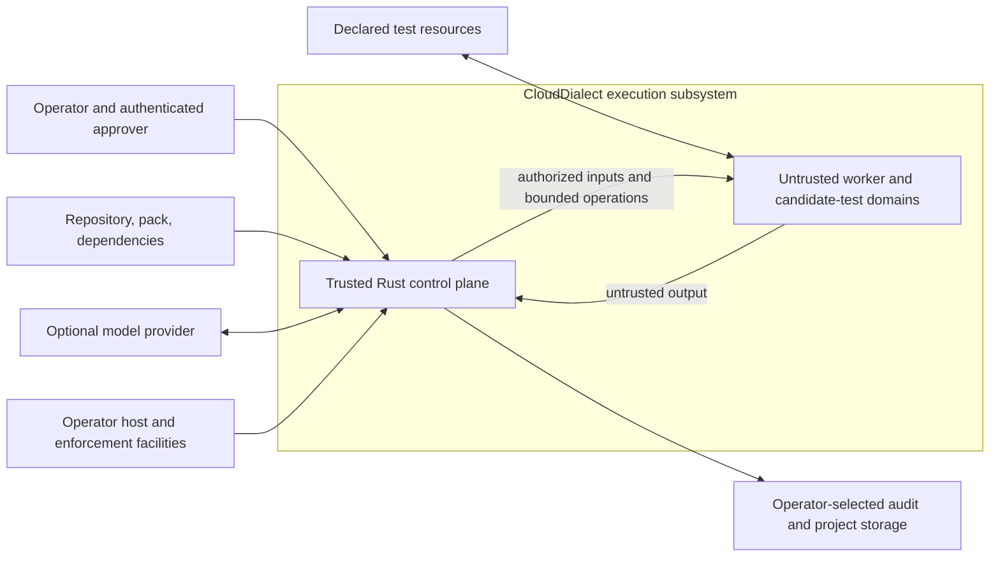
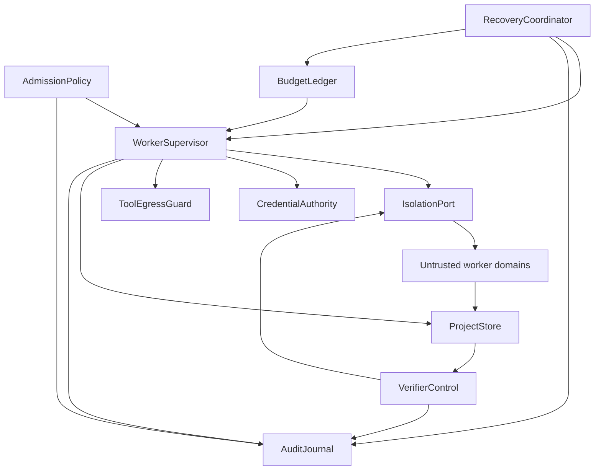
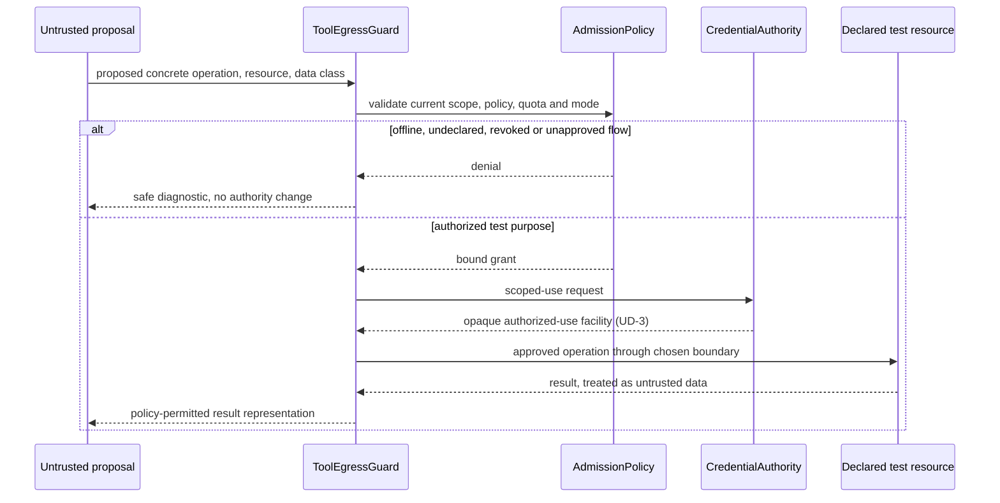

# Design: execution-isolation

## Overview

This is the **conditional technical design for Spec 2**, following the requirements analysis in `analysis.md`. It proposes a trusted Rust control plane around independently confined worker execution, with separate policy, budget, project-data, credential, verifier, audit, and recovery responsibilities. These are logical boundaries, not a commitment to microservices, containers, or a particular sandbox.

**NOT IMPLEMENTATION-READY.** UD-1 through UD-5 remain unresolved; BG-01 blocks integration with nonexistent/disagreeing Spec 1 APIs. Interfaces below are proposed internal contracts, not implemented Rust exports, IPC schemas, or amendments to Spec 1. No runtime dependency, backend, operating-system support claim, numerical budget, retention duration, or credential delivery mechanism is selected. All implementation and qualification evidence is MISSING.

The design consumes `clouddialect-contracts` once its required APIs exist. It never substitutes structural validity, evidence completeness, signatures, process exit codes, or generated explanations for behavioral acceptance. Commercial use remains subject to a separate executed license under the existing CloudDialect licensing model.

## Context Boundary



| External actor / dependency | Direction | Protocol / data | Trust boundary |
|---|---|---|---|
| Operator / approver | Inbound | Integration identity interface unresolved; policies, consent, approval references | Authenticated caller context, never repository-supplied identity strings. |
| Repository / pack / toolchain supplier | Inbound | Files, existing manifests, immutable identities, inventory/provenance | Treat as untrusted executable inputs even when signed. |
| Worker languages and candidate-linked tests | Both | UD-2 IPC, bounded artifacts and diagnostics | Untrusted execution; no control-plane mutation authority. |
| Model provider / external processor | Both, optional | Provider API not selected; approved data-class payloads only | Egress gate before any transmission; no fallback or credentials in context. |
| Declared cloud test resources | Both, optional | Approved resource-specific operation through UD-3 authority | Resource, operation, project, lifetime and quota checks; no production migration. |
| Host enforcement facilities | Both | UD-1 process/resource/network/filesystem controls | Trusted infrastructure prerequisite; unsupported profiles fail closed. |
| Audit / project storage | Both | UD-4 backend and retention undefined; scoped metadata/artifacts | Integrity, durability, tenant/project checks; storage availability never bypasses acceptance gates. |

**Out of scope:** Spec 1 schema redesign, transformation algorithms, production transfer/cutover/deploy/delete execution, commercial delivery, universal resistance to kernel/hardware or privileged-host compromise. Framework-owned data retention/deletion remains in scope; deleting source cloud resources does not.

## Design Constraints

| Constraint | Consequence |
|---|---|
| Rust trusted core; future Python/Go/Java workers | Core-owned authority and language-independent semantics; language cannot weaken isolation. |
| Spec 1 currently only module stubs | BG-01 must deliver compatible APIs before executable integration; proposed names are not compile evidence. |
| Linux, macOS and CI portability must be evaluated | UD-1 must publish a supported-profile matrix; no implicit Linux-only choice or native macOS guarantee. |
| Security controls outside model context | Tools and output are data; concrete operations pass external policy guards. |
| No measured resource values or staffing/cost baseline | UD-5 reference measurements precede budgets; task estimates are planning estimates, not delivery promises. |
| Existing licensing and document-format ownership | No dependency additions or license changes here; new dependencies require compatible-license review during implementation. |
| Five decisions explicitly unresolved | Preserve mechanism-neutral invariants and fail-closed gates; revise affected design/tasks after approval. |

## Architecture



Arrows denote logical calls/data dependencies, not unrestricted worker access. Every worker artifact is quarantined until identity, scope, size, structural and semantic checks pass. Acceptance-control assets live outside every candidate-writable domain; candidate-linked tests are still untrusted execution.

One control-plane coordinator owns the authoritative run ordering. Concurrency is allowed only with distinct attempts and reserved shared-run budgets. No worker/model can self-issue a capability, choose an acceptance rule, submit a trusted approval, or write a successful terminal record. A cached artifact may be reusable data; it is never implicitly fresh verification.

## Components and Interfaces

**Notation:** these are typed internal design signatures, not compilable implementation or a wire format. `ExecError` is an execution-layer error separate from Spec 1's `ValidatorError`. Newtype names below are semantic handles defined in Data Models. Exact serialization, transport and credential bytes remain unresolved. Components can be ordinary modules in one crate; no service fan-out is required.

### Component: WorkerSupervisor

**DES-001** — implements REQ-001, REQ-003, REQ-010.

Responsibilities (4): bind admitted execution context; supervise versioned communication; freeze produced artifact identity; terminate/reap the full execution domain on every attempt-ending path.

Interface:
```rust
fn launch(ctx: AdmittedContext, input: InputSnapshot) -> Result<WorkerHandle, ExecError>;
fn collect(worker: &WorkerHandle) -> Result<UntrustedOutput, ExecError>;
fn stop(worker: &WorkerHandle, reason: StopReason) -> Result<CleanupReceipt, ExecError>;
```

Depends on policy, budget, isolation, credential, audit and project ports. No launch before durable admission, configured retention, approved finite profile, and enforceable confinement. The selected adapter must prove descendant cleanup; a dropped child handle is not cleanup. Candidate output digest is computed only after production, bound to the input/attempt, and frozen before verification. IPC messages are correlated to supervisor-held context, never self-authenticated by a worker-provided project field. UD-1/2/5 block implementation activation.

### Component: IsolationPort

**DES-002** — implements REQ-001, REQ-002, REQ-005, REQ-008.

Responsibilities (4): validate environment support; establish filesystem/handle/network restrictions before code executes; confine the full descendant domain; observe violations and confirmed cleanup.

Interface:
```rust
fn probe(profile: &ApprovedProfile) -> Result<SupportEvidence, ExecError>;
fn create(ctx: &AdmittedContext, grants: &EffectiveGrants) -> Result<DomainHandle, ExecError>;
fn destroy(domain: DomainHandle) -> Result<CleanupReceipt, ExecError>;
```

Depends on UD-1 operator host facilities, not prompt instructions. Policy checks on paths alone cannot defeat link/mount races; the selected boundary must enforce at use time. Network restrictions cover destination resolution, redirects, local/metadata/proxy paths, inherited connections, and descendants. Offline also disables run-serving external core paths; a worker-only network namespace would not by itself satisfy AC-06. Missing offline audit/model inputs block instead of fetching. UD-1 qualification must test observers rather than trusting “disabled” configuration.

### Component: BudgetLedger

**DES-003** — implements REQ-003, REQ-010.

Responsibilities (4): validate measured profiles; reserve before work; account shared-run consumption; preserve accounting through interruption.

Interface:
```rust
fn reserve(run: RunId, demand: ResourceDemand) -> Result<Reservation, ExecError>;
fn settle(reservation: Reservation, observed: UsageReceipt) -> Result<RemainingBudget, ExecError>;
fn recover(checkpoint: &Checkpoint) -> Result<RemainingBudget, ExecError>;
```

Depends on authoritative state and UD-5 measurement/accounting definitions. CPU usage sums across descendants; wall time uses the run's original clock basis rather than a retry reset. Memory is an aggregate live reservation/peak constraint, not a meaningless sum of historical bytes. Storage/output/process/external-use accounting must define units and reservation reconciliation in UD-5. Enforcement overshoot/sampling limits must be measured and disclosed; missing accounting blocks resumption. No numerical values are guessed.

### Component: AdmissionPolicy

**DES-004** — implements REQ-004, REQ-008, REQ-009.

Responsibilities (5): authenticate invocation context; intersect capability sources; verify artifact/provenance admission; check freshness/revocation; distinguish propose/approve/deploy/delete authority.

Interface:
```rust
fn admit(caller: AuthenticatedCaller, request: ExecutionRequest) -> Result<AdmittedContext, ExecError>;
fn authorize(ctx: &AdmittedContext, action: ConcreteAction) -> Result<EffectiveGrant, ExecError>;
fn check_approval(binding: &VerificationBinding, approval: ApprovalRef) -> Result<ApprovalReceipt, ExecError>;
```

Depends on Spec 1 validation, operator identity/policy roots, approved profile, budget availability and audit. Pre-candidate grants bind the admitted input/context, not a nonexistent future output digest. Candidate-specific grants and approvals bind the frozen candidate/protected verification identity as well as current project, operation, policy and validity. The capability declaration format requires BG-01; arbitrary optional `[x]` values cannot act as grants. The catalog is admitted trusted material, not ambient environment selected by a worker. Provenance and signature verification bind executable digests, dependency inventory, permitted versions and signer policy, but do not exempt code from isolation. No deploy/delete execution path is introduced.

### Component: CredentialAuthority

**DES-005** — implements REQ-005, REQ-004, REQ-010.

Responsibilities (4): validate resource/operation/lifetime scope; provide the selected scoped-use facility; revoke attempt authorization; keep secret values outside control evidence/model context.

Interface:
```rust
fn authorize_use(ctx: &AdmittedContext, purpose: TestOperation) -> Result<CredentialUseHandle, ExecError>;
fn revoke(handle: CredentialUseHandle) -> Result<RevocationReceipt, ExecError>;
fn validate_use(handle: &CredentialUseHandle, action: &ConcreteAction) -> Result<(), ExecError>;
```

`CredentialUseHandle` is an opaque reference, never a token string in a prompt, audit, or checkpoint. It does not select proxy versus file versus environment delivery. UD-3 must prove lifetime, cleanup, revocation behavior and residual authority after worker compromise. If direct credential access is selected, a worker may retain bytes or misuse already authorized operations; the threat report must state this. Revoking local authorization alone cannot be presented as proof of cloud credential invalidation. No credential fallback or replay after restart is allowed.

### Component: ToolEgressGuard

**DES-006** — implements REQ-006, REQ-002, REQ-005.

Responsibilities (4): authorize concrete tool operations; protect acceptance rules; enforce data-class routing/retention policy; constrain diagnostic/export channels.

Interface:
```rust
fn authorize_tool(ctx: &AdmittedContext, proposal: UntrustedToolRequest) -> Result<AuthorizedAction, ExecError>;
fn authorize_egress(ctx: &AdmittedContext, flow: DataFlow) -> Result<EgressReceipt, ExecError>;
fn sanitize_diagnostic(input: UntrustedDiagnostic, policy: &DataPolicy) -> Result<SafeDiagnostic, ExecError>;
```

Depends on AdmissionPolicy and operator data policies. Unknown/secret-bearing diagnostics are discarded or quarantined under approved policy, not sent to a model while hoping regex redaction catches everything. `SafeDiagnostic` means an allowed data-class representation, not a guarantee of detecting all arbitrary encoded secrets. Offline forbids external processors, including “helpful” provider failover. Authorized outputs still need behavioral verification because permission is not truth.

### Component: ProjectStore

**DES-007** — implements REQ-007, REQ-001, REQ-006, REQ-010.

Responsibilities (5): enforce project scope on every operation; freeze/validate artifact identities; partition private caches/retrieval; apply retention/deletion; preserve restrictions on restore.

Interface:
```rust
fn put(ctx: &AdmittedContext, class: DataClass, content: UntrustedArtifact) -> Result<ArtifactRef, ExecError>;
fn get(caller: AuthenticatedCaller, artifact: &ArtifactRef) -> Result<ScopedArtifact, ExecError>;
fn expire(caller: AuthenticatedCaller, selection: ProjectDataSelection) -> Result<DeletionReceipt, ExecError>;
fn restore(caller: AuthenticatedCaller, snapshot: SnapshotRef) -> Result<RestoreReceipt, ExecError>;
```

Depends on authorized scope, data policies, integrity checks and selected storage behavior. Cache lookup includes trusted tenant/project context plus admitted input, toolchain and policy compatibility; identical hashes from another project do not grant access. Public immutable toolchain/catalog material is the only proposed cross-project reuse class. Missing retention policy denies persistence and any dependent launch. Deletion receipts distinguish live-access invalidation, pending backup expiry and external recipient limitations; they do not promise recall of exported data.

### Component: VerifierControl

**DES-008** — implements REQ-008, REQ-004, REQ-006, REQ-009, REQ-010.

Responsibilities (5): validate immutable inputs via Spec 1; freeze obligations/oracles; obtain independently attributable observations from confined candidate execution; assemble non-interchangeable results; gate acceptance.

Interface:
```rust
fn prepare(ctx: &AdmittedContext, candidate: ArtifactRef, suite: ProtectedSuiteRef) -> Result<VerificationBinding, ExecError>;
fn evaluate(binding: &VerificationBinding, observations: AuthenticatedObservations) -> Result<BehavioralResult, ExecError>;
fn propose_acceptance(binding: &VerificationBinding, result: &BehavioralResult, approval: ApprovalReceipt) -> Result<AcceptanceIntent, ExecError>;
```

Depends on contracts, isolated execution, trusted test/oracle selection, source-authenticated observations, ProjectStore and RecoveryCoordinator's final commit gate. `AuthenticatedObservations` is not created by parsing worker JSON marked “trusted.” Qualification must attack runner import shadowing, forged result files, logs and disabled instrumentation. The observation-channel mechanism must be resolved within UD-1/2's verifier-boundary evidence; if it cannot distinguish forged evidence, implementation remains blocked.

BehavioralResult is the upstream type, with fields/outcomes deliberately unspecified here pending BG-01. `Deferred`/`EvidenceComplete` never authorize acceptance. Missing/unknown/failed/skipped/stale obligations map to `BlockingGap` or the agreed upstream error mapping. No conversion from structural/semantic success to behavioral pass. Acceptance requires complete current evidence, fresh approval, matching hashes, cleanup confirmation, valid policy/accounting and durable commit. Positive-control acceptance tests accompany all negative suites.

### Component: AuditJournal

**DES-009** — implements REQ-009, REQ-007, REQ-005, REQ-010.

Responsibilities (4): persist attributable transitions; protect integrity and linkage; enforce audit access/retention; provide durability and restore receipts.

Interface:
```rust
fn append(event: AuditEvent, prior: Option<AuditRef>) -> Result<DurableAuditRef, ExecError>;
fn inspect(caller: AuthenticatedCaller, run: RunId) -> Result<AuditView, ExecError>;
fn verify_restore(snapshot: SnapshotRef) -> Result<AuditIntegrityReceipt, ExecError>;
```

Depends on UD-4's chosen durability/tamper-evidence/access mechanism. No append-only filesystem or database is silently selected. Correlation references must remain meaningful when content is expired; a tombstone can identify unavailable content without exposing it or pretending it is still verifiable. If durable admission is unavailable, no launch. If later audit writes fail, stop new work and acceptance but still revoke/contain/terminate. On recovery record observable gaps; do not manufacture missing events or silently declare success.

### Component: RecoveryCoordinator

**DES-010** — implements REQ-010, REQ-001, REQ-003, REQ-005, REQ-008, REQ-009.

Responsibilities (5): order authoritative state transitions; persist/check checkpoints; classify retries and effects; reconcile cleanup and consumption; commit or read back terminal outcomes.

Interface:
```rust
fn checkpoint(state: &RunState, boundary: CheckpointBoundary) -> Result<CheckpointRef, ExecError>;
fn resume(reference: CheckpointRef, caller: AuthenticatedCaller) -> Result<ResumeDisposition, ExecError>;
fn cancel(run: RunId, caller: AuthenticatedCaller) -> Result<TerminalOrStopping, ExecError>;
fn commit(intent: AcceptanceIntent) -> Result<CommittedAcceptance, ExecError>;
```

Depends on all relevant policy, budget, cleanup and audit receipts. Exact transaction/journaling technology is UD-4; do not equate an append call returning locally with proved durability. The commit operation must establish one authoritative order with cancellation, revocation and budget exhaustion. Cannot reopen a terminal attempt. Reconciliation may authorize a new attempt within remaining budget; it never converts an unresolved external write to a retryable failure.

## Data Models

These are **logical internal data contracts**, not selected IPC/JSON schemas. No new format is imposed on Spec 1. Relationships and query keys express authorization needs; physical indexes and serialization belong to the selected implementation.

| Entity / typed handle | Required content and validation | Relationships / query needs |
|---|---|---|
| `AuthenticatedCaller`, `Scope` | Validated identity and tenant/project authority from operator integration, not worker claims | One caller may have explicit grants to multiple scopes; every lookup rechecks the requested scope. |
| `AdmittedContext` | Scope, RunId, AttemptId, InputIdentity, pack/toolchain digests, policy revision, profile ID, mode, reservation and durable admission refs | One run has multiple distinct attempts; admission keyed by scope/run/attempt. |
| `InputSnapshot`, `ArtifactRef` | Exact bytes/material digests; required origin input and producing attempt for outputs; no path-only identity | Immutable candidate maps to one producing context; scoped digest lookup never bypasses authorization. |
| `ApprovedProfile`, `ResourceDemand`, `UsageReceipt` | Finite bounds with explicit units, measured workload ID, support evidence, observed consumption or unknown-accounting marker | Profile and enforcement evidence version bound to run; UD-5 supplies actual values. |
| `EffectiveGrant`, `CredentialUseHandle` | Concrete action/resource/purpose/project, policy binding, validity; handle opaque and non-exportable | Grant does not outlive its valid policy/attempt; no credentials in persisted references. |
| `VerificationBinding`, `AuthenticatedObservations` | Input/candidate/suite/oracle/toolchain/configuration/policy digests, obligation/test set, attempt, independently checked observation origin | Immutable binding identifies the exact verification claim; observations from another attempt cannot be relabelled. |
| `AuditEvent`, `DurableAuditRef` | Scope/run/attempt/transition identities, timestamp/order, attributable actor, artifact/approval/decision links, budget disposition | Sequential authoritative history; missing links make decision evidence invalid. Storage/index mechanism UD-4. |
| `Checkpoint`, `RunState` | Boundary, terminal/intermediate state, bindings, remaining/consumed budget, known effect disposition, cleanup status, audit references | Lookup scoped to run/attempt; recovery checks integrity and current authorization before use. |
| `DeletionReceipt`, `RestoreReceipt` | Affected project/data classes, live access disposition, retained copies/conditions, authorization and integrity outcomes | Restore checks deletion restrictions before exposing data; no claim that exported copies can be recalled. |
| `ExecError` | Semantic code, safe message, affected scope/attempt, retry classification, optional consumed ValidatorError/BlockingGap references | Not an extension of Spec 1 ErrorCategory and not a chosen wire code. |

**Illustrative metadata projection only** (not an IPC message or normative serialized schema):
```json
{
  "project_ref": "synthetic-project-a",
  "run_ref": "synthetic-run",
  "attempt_ref": "synthetic-attempt-2",
  "boundary": "verification-complete",
  "candidate_ref": "immutable-artifact-reference",
  "budget_ref": "remaining-budget-reference",
  "audit_ref": "durable-record-reference"
}
```
No credential-value field belongs in the record. Physical checkpoint format is gated by UD-4/BG-01.

## Runtime Interactions

### Flow: Authenticated admission and primary success

Trigger: an authenticated operator/core requests analysis or transformation.

```mermaid
sequenceDiagram
  participant U as Authenticated caller
  participant A as AdmissionPolicy
  participant J as AuditJournal
  participant S as Supervisor and isolation
  participant V as VerifierControl
  participant R as RecoveryCoordinator
  U->>A: request and admitted input identity
  A->>A: validate contracts, policy, profile, retention and budget
  alt missing control, decision or authorization
    A-->>U: explicit blocker; no launch
  else admitted
    A->>J: durable admission and dispatch intent
    J-->>A: durability receipts
    A->>S: bound context with reserved budget
    S->>S: confine before code, execute, freeze output, clean descendants
    S->>V: immutable candidate and confirmed cleanup
    V->>S: separately confined candidate-linked test execution
    S-->>V: independently attributable observations and cleanup
    V->>V: complete checks against protected suite
    U->>A: independently authenticated approval for binding
    A-->>R: fresh approval receipt
    V->>R: acceptance intent, not success
    R->>R: serialize safety checks versus cancel/revocation/exhaustion
    R->>J: durable acceptance commit
    J-->>R: committed record
    R-->>U: accepted within declared contract
  end
```

Steps: authenticate → preflight/validation → durable admission/reservation/dispatch intent → confined work → immutable output → independent confined verification → fresh approval → authoritative durable acceptance. Failure at any dependency prevents its downstream step; no partial verification is promoted. A verification-only request starts with an existing candidate identity. An approval is not a worker-supplied string or proof of deployment permission.

### Flow: Untrusted tool request and credential authorization

Trigger: worker/model proposes an external test operation.



Authentication and authorization happen outside model context at the concrete use boundary. Actual credentialed-call placement depends on UD-3; the diagram does not select a proxy. Failure before dispatch means no operation; timeout after an external mutation creates unknown effect disposition until reconciled. Caller credentials never become model-visible output.

### Flow: Crash, cancellation and recovery

Trigger: worker crash/disconnect, cancellation, budget limit, or control-plane restart.

```mermaid
sequenceDiagram
  participant E as Failure or cancel event
  participant R as RecoveryCoordinator
  participant S as Supervisor and isolation
  participant C as CredentialAuthority
  participant J as AuditJournal
  E->>R: order event against acceptance
  alt acceptance already durably committed
    R-->>E: read back terminal result; no replay
  else not accepted
    R->>R: prohibit dispatch and acceptance
    R->>C: revoke attempt authorization
    R->>S: terminate and reap full domain; start cleanup deadline
    S-->>R: confirmed cleanup or quarantine
    R->>J: checkpoint/terminal evidence if storage available
    alt unknown effects, accounting, integrity or cleanup
      R-->>E: terminal blocker; preserve reservations/quarantine
    else recoverable and explicitly authorized
      R->>R: new attempt or validated checkpoint continuation
      R-->>E: remaining-budget, current-policy disposition
    end
  end
```

Emergency containment does not wait for audit availability. An inability to persist its outcome creates a recovery blocker, not invented historical evidence. Late messages from a stopped attempt cannot modify terminal outcomes. A new attempt gets fresh authorization; ordinary worker reconnect does not resume privileges.

### State transitions and checkpoints

| State | Class | Allowed next state / condition |
|---|---|---|
| prepared | Intermediate | running after durable intent and enforced controls; stopping on failure/cancel. |
| running | Intermediate | verifying after output freeze and worker cleanup; stopping on any attempt-ending failure/cancel. |
| verifying | Intermediate | committing after all required evidence, verifier cleanup and fresh approval; stopping on rejection/failure/cancel. |
| committing | Intermediate | accepted only after authoritative durable acceptance; stopping if a prior ordered safety event wins; recovery reconciles uncertain commit. |
| stopping | Intermediate | cancelled for confirmed user cancellation; rejected for confirmed validation/behavioral failure; blocked for unresolved controls/effects/cleanup. No return to running. |
| accepted / rejected / blocked / cancelled | Terminal | No transition in the same attempt. Read back accepted; separately authorize any new attempt for other outcomes. |

Quarantine is a resource disposition independent of terminal attempt state: a blocked attempt can retain a quarantined domain/reservation. Operator cleanup does not reopen the attempt. A pre-admission rejection may have no launched domain but still records an attributable denial when audit is available.

| Checkpoint | Durable prerequisites / content | Crash before / after, and resume rule |
|---|---|---|
| CP-0 admission | Scope/input identity, valid profile/policies, run budget reservation, admission audit | Before: no execution authority. After: no replay until receipt integrity/accounting checked. |
| CP-1 dispatch intent | Intended domain/operation/attempt identity and resource/effect intent before allocation/credential use/worker launch | Reconcile any partially allocated domain, credential authorization, or external operation; unknown effect means blocker. |
| CP-2 worker completion | Output identity, observed execution/usage, revoked credential authorization, confirmed cleanup or explicit quarantine | Before: outputs untrusted/incomplete. After: candidates may proceed only with confirmed cleanup and same binding. |
| CP-3 verification completion | Protected binding, independently attributable results, all obligation dispositions, verifier cleanup | Before: no verification success. After: evidence may be considered only for the same attempt/binding under current policy. |
| CP-4 acceptance commit | Fresh approval, complete matching evidence, valid policy/budget, confirmed cleanup, authoritative durable terminal record | Intent alone is not success. On timeout/crash, read/reconcile authoritative record; inability to decide blocks, never blindly replays. |

Inject failures on both sides of every checkpoint and during allocation, credential authorization, audit write, external mutation, and commit. A valid checkpoint continuation keeps the same attempt only when no terminal outcome exists and all bindings remain valid. An authorized retry creates a new attempt and reruns behavioral verification; it may reuse verified immutable input artifacts but not transplant a prior attempt's pass result.

## Error Handling and Resilience

Semantic categories here do not select UD-2 numeric wire codes. Every retry consumes run budget. Backoff/attempt/time values must be approved through UD-5; no unbounded waiting or undocumented defaults. Circuit-breaker mechanisms are not required for local ports; fail-closed dispatch gating is sufficient until evidence supports more machinery.

| Dependency / category | Error examples | Action / recovery | Retry | Timeout | Circuit breaker / fallback |
|---|---|---|---|---|---|
| Spec 1 validation / API | ValidatorError, UPSTREAM_CONTRACT_UNRESOLVED | Deny dependent operation; correct upstream/document, then explicitly authorize new attempt | Never automatic | Profile parsing/validation bound | Not applicable; no alternate validator/network loader. |
| Host isolation / IPC | ISOLATION_UNAVAILABLE, PROTOCOL_VIOLATION, ISOLATION_VIOLATION | Stop, revoke, reap; quarantine unconfirmed cleanup | No automatic retry of unsupported/violating input | Startup, parse, execution, cleanup limits from approved profile | Fail closed; no unsandboxed fallback. |
| Identity / policy / artifacts | PERMISSION_DENIED, ARTIFACT_IDENTITY_MISMATCH | Deny; fresh approved identity/policy/artifact needed | Never automatic | Approved authorization bound | No fallback grant or alternate signer. |
| Budgets | BUDGET_UNCONFIGURED, BUDGET_EXHAUSTED, ACCOUNTING_UNKNOWN | Deny/stop; unknown consumption blocks recovery | No automatic reset/retry | Original cumulative run deadline | No replenishment on restart. |
| Credential authority / cloud calls | CREDENTIAL_UNAVAILABLE, unresolved external effect | Stop dependent work; revoke local use; reconcile cloud effect/lifetime | Only classified transient failures with proven idempotent/reconciled outcome and fresh authorization | Per-operation/profile limit from UD-3/5 | Fail closed; no ambient credential fallback. |
| Model / tool egress | EGRESS_DENIED, OFFLINE_DEPENDENCY, UNTRUSTED_AUTHORITY_REQUEST | Deny transmission; safe diagnostic only | Denial never retried automatically | Approved external-use bound | No provider failover. |
| Project storage / retention | RETENTION_UNCONFIGURED, CACHE_INVALID | Deny persistence or reject cache; block launch if required; recompute only with authorized budget | Transient store failure only when no ambiguous write remains | Approved I/O bound | No private cross-project cache fallback. |
| Audit / checkpoint store | AUDIT_UNAVAILABLE, RECOVERY_BLOCKED | Stop dispatch/acceptance; allow emergency containment; reconcile durable outcome before restart | No blind append/commit replay; reconcile identity first | Approved durability/cleanup bounds | Dispatch gate closed; no success from volatile-only log. |
| Verification | EVIDENCE_IDENTITY_MISMATCH, BlockingGap | Non-accepting result; preserve complete obligation diagnostics | Never relabel old evidence; new authorized verification only | Verification included in run budget | No worker self-attestation fallback. |

## Architecture Decisions

### ADR-001: Separate authority from executable content

**Status:** Proposed invariant design, conditional on qualification; requirement intent approved for drafting.
**Context:** REQ-001, REQ-004, REQ-006 and REQ-008 prohibit candidate-controlled authority.
**Decision:** Keep policy, test/oracle selection, approval and final commit in trusted control-plane modules. Execute all candidate-linked code under the selected isolation boundary. Options rejected: prompt-only permission enforcement; trusting signed packs as benign; treating a test runner's stdout as an authenticated verdict.
**Consequences:** [+] Clear ownership of authority; [-] isolation and observation channels require real platform evidence; [!] a compromised trusted host/oracle remains outside guaranteed containment.

### ADR-002: Preserve upstream ownership and open mechanisms

**Status:** Proposed, gated by BG-01 and UD-1 through UD-5.
**Context:** REQ-001 through REQ-010 depend on missing upstream contracts and five deliberately unresolved choices.
**Decision:** Specify logical ports and decision evidence, not invented backends or schema variants. Compare alternatives before accepting any choice. Use Spec 1 result/error/catalog contracts once reconciled; retain an execution-layer error wrapper rather than altering its ErrorCategory.
**Consequences:** [+] No hidden incompatible contract; [-] implementation cannot begin merely because docs validate; [!] revising approved choices requires affected requirements/design/tasks to be re-gated.

### ADR-003: One authoritative acceptance order with fail-closed recovery

**Status:** Proposed, persistence mechanism unresolved under UD-4.
**Context:** REQ-003, REQ-008, REQ-009 and REQ-010 require cancellation, durable audit and acceptance to agree.
**Decision:** Acceptance intent and committed acceptance are distinct. Reconcile uncertain writes before replay. Keep terminal attempt outcomes immutable and require new authorization for retries. Alternatives rejected: last-writer-wins worker reports; acceptance before durable evidence; blind retry after timeout.
**Consequences:** [+] No stale/incomplete success; [-] some failures terminate as explicit blockers instead of automatic recovery; [!] the selected backend must prove ordering/durability under failure injection.

### ADR-004: No private cross-project reuse

**Status:** Proposed invariant design.
**Context:** REQ-005 through REQ-007 require isolation and controlled egress even within one tenant.
**Decision:** Share only operator-admitted immutable public material. Private artifacts, caches and retrieval are project-bound. Require class-specific retention before persistence. Do not use content equality as authorization.
**Consequences:** [+] Avoid cross-project cache leakage; [-] duplicate private computation/storage; [!] backup and recipient deletion limitations must remain visible.

## Correctness Properties

### Property 1: No unadmitted execution
*For any* worker or descendant, execution SHALL imply a bound input/context, current effective grant, finite approved profile and enforced confinement.
**Validates: Requirements 1.1, 1.2, 1.3, 1.9, 2.8, 4.1, 4.2**

### Property 2: Offline containment
*For any* offline run, worker and run-serving dependency traffic SHALL remain zero outbound; missing dependencies block.
**Validates: Requirements 2.4, 2.5, 2.6, 2.7, 6.6**

### Property 3: Budget monotonicity and terminal cleanup
*For any* reservation, retry, restart or descendant, available run allowance SHALL not increase through identity reset or uncertain cleanup.
**Validates: Requirements 1.6, 1.7, 1.11, 3.3, 3.4, 3.5, 3.9, 3.10**

### Property 4: No self-granted authority
*For any* untrusted content or validly signed pack, effective permissions SHALL remain within current external authorization.
**Validates: Requirements 4.1, 4.3, 4.4, 4.5, 4.6, 4.7, 4.8, 4.9, 6.1, 6.2, 6.3, 6.4**

### Property 5: Project and secret separation
*For any* private artifact or credential use, the authorized project/data-flow boundary SHALL hold independent of caller-provided labels or equal content hashes.
**Validates: Requirements 5.1, 5.2, 5.3, 5.4, 5.8, 5.9, 6.5, 7.1, 7.2, 7.3, 7.4, 7.5**

### Property 6: Acceptance is stronger than evidence completeness
*For any* accepted attempt, complete independently attributable checks, exact immutable bindings, fresh approval and durable safety-checked commitment SHALL all exist.
**Validates: Requirements 1.8, 1.10, 8.1, 8.2, 8.3, 8.4, 8.5, 8.6, 8.7, 8.8, 8.9, 8.11, 8.13, 10.12**

### Property 7: Interruption cannot create success
*For any* interrupted checkpoint or uncertain effect, recovery SHALL preserve a valid prior committed result, resume only validated nonterminal work, or produce an explicit blocker.
**Validates: Requirements 3.6, 3.7, 3.8, 5.5, 5.6, 5.7, 9.5, 9.6, 10.1, 10.2, 10.3, 10.4, 10.5, 10.6, 10.7, 10.8, 10.9, 10.10, 10.11, 10.13**

### Property 8: Persistence does not bypass policy
*For any* persisted or restored project record, integrity, scope, retention and deletion restrictions SHALL be validated before access or decision use.
**Validates: Requirements 7.6, 7.7, 7.8, 7.9, 7.10, 7.11, 7.12, 9.1, 9.2, 9.3, 9.4, 9.7**

## Testing Strategy

All tests below are planned, not run. No Rust runtime worker crate exists yet. Document checks and the existing scaffold tests are not substitutes.

| Layer | Cases / oracle | Scope and gating |
|---|---|---|
| Unit / property-based | Grant intersection, identity mismatch, budget monotonicity, state transitions, duplicate/reordered IPC events, retention absence, no accepting conversion | Generated parameter values around each approved bound; mocks test control logic only. |
| Contract integration | Real Spec 1 validation/results, upstream outcome mapping, manifest capability semantics, catalog integrity, verified failure details/configuration | Blocked by BG-01; no invented or mock-only compatibility claim. |
| Host integration | Actual confinement before startup, descendant kill/reap, mount/link/descriptor/socket escape, quotas and network observation | Each UD-1 supported profile; positive observer controls must detect deliberately generated traffic/forbidden-access probes in disposable fixtures. |
| Credential / egress | Canary secrets across model/log/checkpoint/export paths, forbidden resource/operation, expiry, direct-consumer residual risk, offline core paths | Synthetic credentials/resources only until separately approved live-resource tests. No real secret material in test reports. |
| Behavioral / AC-05 | Valid positive candidate; every seeded critical defect; assertion removal, import shadowing, forged/stale/missing/partial/skip results and candidate/rule swaps | Independently controlled fixtures and observation provenance; no self-reported pass. |
| Interruption / AC-08 | Before/after CP-0 through CP-4, partial allocation, credential authorization, store outage, unknown cloud effect, cancellation versus commit, late messages | Safe validated continuation or explicit terminal blocker; old pass cannot become a new attempt's evidence. |
| Isolation / AC-06 | T-01 through T-06, same-tenant different-project and different-tenant access, private cache poisoning, retention/deletion/restore | Zero forbidden access and zero run-attributable outbound traffic offline within measured suite; report observer limitations. |
| Performance / resource | Reference workload plus saturation/fork/output/storage attacks; limit enforcement lag and accounting behavior | UD-5 must produce measured budgets before acceptance thresholds; no current SLA claim. |
| Operational / release | Signed executable inventory and provenance, malicious signed pack, audit restore/tamper detection, quarantine runbook drill, compatibility matrix | Actual qualification reports per environment; inventory is not proof of harmlessness. |

### Criterion-to-design coverage

Every numbered criterion appears below; test families refer to the table above and threat IDs in requirements. This is coverage planning, not passing evidence.

| Requirement | Criteria | Design owner | Test family |
|---|---|---|---|
| REQ-001 | 1.1, 1.2, 1.3, 1.4, 1.5, 1.6, 1.7, 1.8, 1.9, 1.10, 1.11 | DES-001, DES-002 | Host/IPC lifecycle; T-01; malformed 1.4/1.5 handshakes and late messages. |
| REQ-002 | 2.1, 2.2, 2.3, 2.4, 2.5, 2.6, 2.7, 2.8, 2.9 | DES-002, DES-006 | Host containment/network; T-01/T-05/T-06. |
| REQ-003 | 3.1, 3.2, 3.3, 3.4, 3.5, 3.6, 3.7, 3.8, 3.9, 3.10 | DES-003, DES-010 | Unit/property, reference measurements, interruption. |
| REQ-004 | 4.1, 4.2, 4.3, 4.4, 4.5, 4.6, 4.7, 4.8, 4.9, 4.10 | DES-004 | Admission/provenance; T-02/T-03; release inventory. |
| REQ-005 | 5.1, 5.2, 5.3, 5.4, 5.5, 5.6, 5.7, 5.8, 5.9 | DES-005, DES-006 | Credential/egress; T-05. |
| REQ-006 | 6.1, 6.2, 6.3, 6.4, 6.5, 6.6, 6.7, 6.8 | DES-006 | Prompt injection/egress; T-02/T-06, audit routing receipts. |
| REQ-007 | 7.1, 7.2, 7.3, 7.4, 7.5, 7.6, 7.7, 7.8, 7.9, 7.10, 7.11, 7.12 | DES-007 | Partition/retention/restore; T-06, missing-policy negative test. |
| REQ-008 | 8.1, 8.2, 8.3, 8.4, 8.5, 8.6, 8.7, 8.8, 8.9, 8.10, 8.11, 8.12, 8.13 | DES-008 | Contract/AC-05; T-04 plus valid positive control. |
| REQ-009 | 9.1, 9.2, 9.3, 9.4, 9.5, 9.6, 9.7, 9.8, 9.9 | DES-009 | Audit/restore/outage, release qualification and runbook review. |
| REQ-010 | 10.1, 10.2, 10.3, 10.4, 10.5, 10.6, 10.7, 10.8, 10.9, 10.10, 10.11, 10.12, 10.13 | DES-010 | State/property and full checkpoint failure injection. |

## Decision Gates and Upstream Handoff

| Gate | What must be approved before activation | Evidence that closes it |
|---|---|---|
| UD-1 | Host isolation/observation mechanism and supported Linux/macOS/CI profiles | Portability/maintenance/security comparison plus real malicious-script, descendant, forged-observation and escape qualification. |
| UD-2 | Exact versioned IPC framing, messages, compatibility, limits and errors | Language-neutral protocol specification and malformed/replay/backpressure/cancellation tests. JSON-RPC-over-stdio remains recommendation only. |
| UD-3 | Credential delivery and effective expiry/revocation | Scope/secret-exposure comparison, lifecycle and canary leak tests, residual authority documented. |
| UD-4 | Audit/project persistence, ordering/durability and retention/deletion classes | Failure/restore tests, access and tamper evidence, explicit retention values/policies, offline compatibility. |
| UD-5 | Units, values, enforcement/accounting semantics for every finite limit | Reproducible reference workload and saturation results, measured enforcement overshoot, approved profile. |
| BG-01 | Real upstream types/schema contract and capability representation | Spec 1 owner resolves `test_results`/outcomes, configuration/failure detail, optional-extension authority and catalog override; delivered compile-tested crate version. |

The decision phase may propose amendments; only owners can approve them. No task can claim these gates closed solely by adding this table. Integration tasks stop on unreconciled APIs rather than creating competing formats.

## Documentation Evidence

Fetched on 2026-10-22 through Context7 (resolve then query), corroborated against primary docs:

- Selected `/rust-lang/rust` for standard-library source coverage. `Command` inherits environment by default; `env_clear` removes inherited variables. Explicit environment/stdio policy is therefore necessary but not sufficient isolation. [Rust Command](https://doc.rust-lang.org/std/process/struct.Command.html)
- `Child` is not automatically killed or waited on when dropped. Lifecycle cleanup must be explicit. The inference that an entire descendant domain needs separately qualified cleanup is a design requirement, not a documented whole-tree guarantee of `Child::kill`. [Rust Child](https://doc.rust-lang.org/std/process/struct.Child.html)
- Selected `/websites/jsonrpc` because it indexes the primary JSON-RPC specification. JSON-RPC defines transport-agnostic message semantics; it does not settle this application's stdio framing or authorization. UD-2 remains open. [JSON-RPC 2.0 specification](https://www.jsonrpc.org/specification)

Repository facts were read directly at the baseline: Spec 1 `design.md` result definitions and loader; `tasks.md` tasks 8–15 and manifest work; actual `src/lib.rs` and stub modules. The code-review graph advertised a different branch/commit, so it was not used as current evidence.
