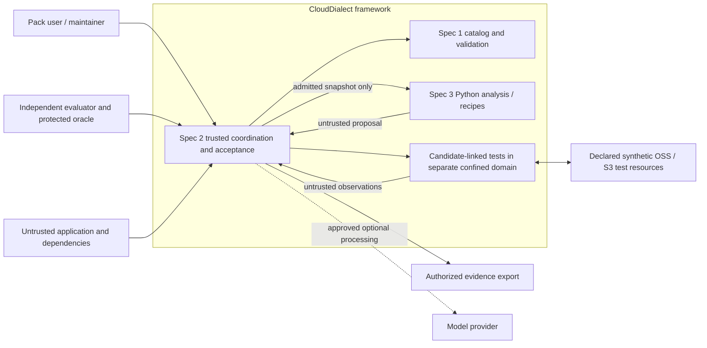
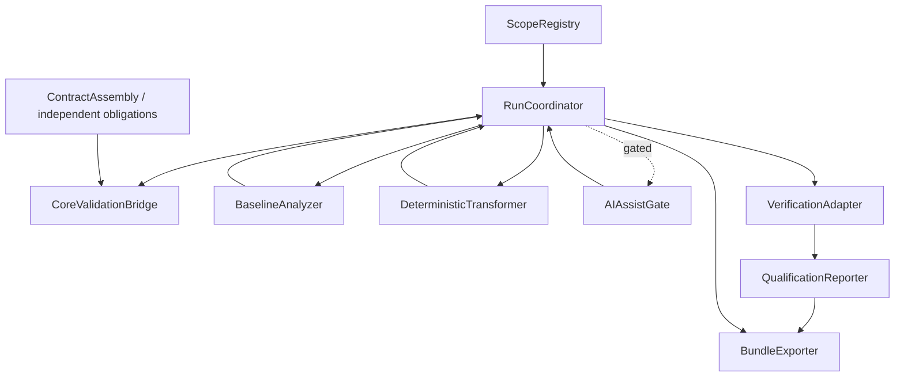
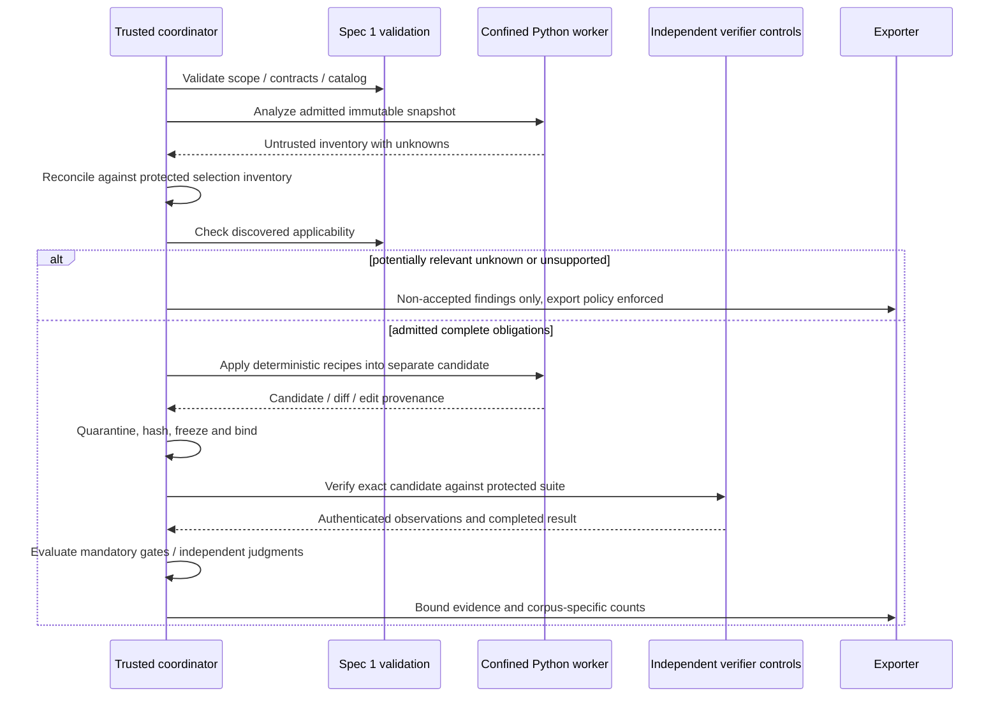
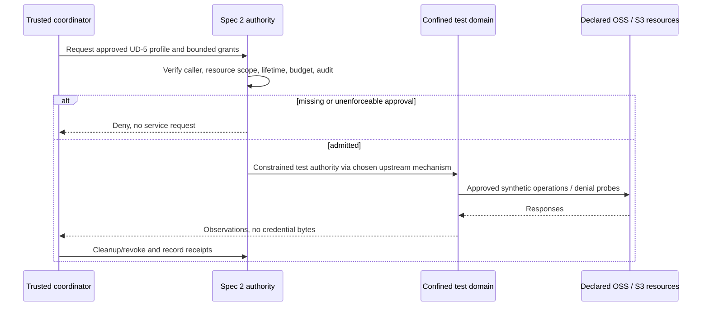
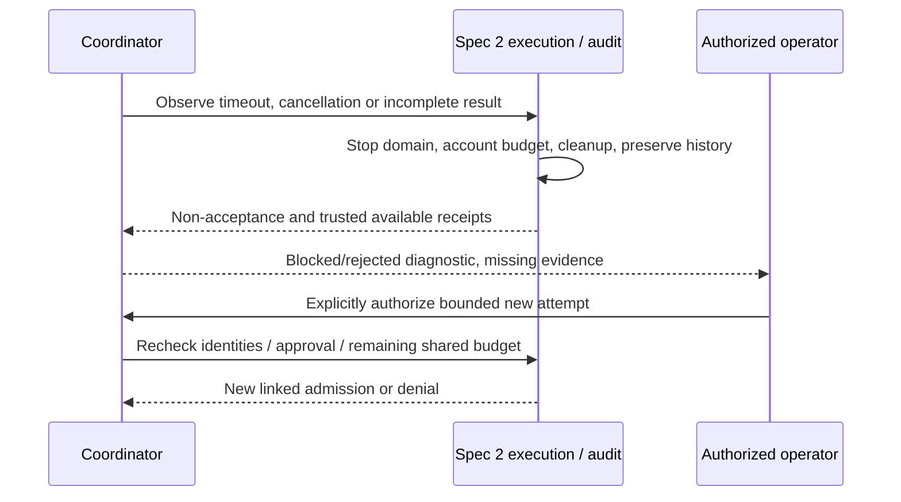

# Design: python-oss-to-s3-pack

## Overview

This conditional design follows the resolved manual findings in `analysis.md`. It specifies a small Python migration pack behind the trusted core's Spec 1 validation and Spec 2 execution/verification controls. The pack proposes changes; it does not award itself acceptance.

**NOT IMPLEMENTATION-READY.** UD-1 through UD-5 and BG-01 through BG-03 remain open. Interfaces and records below are **logical proposals**, not shipped APIs, Python bindings for Rust, new catalog schemas, an IPC format or a chosen sandbox. No source/target compatibility profile, final workload admission, corpus, cloud environment or AI provider is approved. All pack runtime/qualification evidence is MISSING.

2026-10-30 preparation: a separately authorized [document-store reference
candidate](../../../examples/python-oss-document-store/README.md) now supplies
three OSS call sites and a local-only demo/test suite. Its candidate `oss2`
source version is not an approved source/target compatibility profile. This is
workload preparation, not implementation of the pack components below.

The mandatory deterministic path must demonstrate the complete bounded reference migration. AI is optional and unavailable until its own approval/evidence gates close. A valid negative-control suite alone is not sufficient: qualification also needs a valid positive control and a successful deterministic reference candidate.

## Context Boundary



| External boundary | Direction / proposed protocol | Exchanged data / authority |
|---|---|---|
| User / maintainer | Inbound core integration, not a new pack CLI | Workload/scope decisions and run requests; caller authentication belongs to Spec 2. |
| Application / pack source | Inbound immutable artifact references | Untrusted code/configuration; reading is not permission to import or execute. |
| Spec 1 | Core-side calls, signatures gated BG-01/02 | Offline schema/semantic checks and inventory-aware applicability; no worker-chosen schema URL fetch. |
| Spec 2 | Approved execution/IPC/audit ports, gated BG-03 | Authority, snapshots, budget, output quarantine, independent observations and cleanup. |
| Independent evaluator | Protected core-side assets | Authored suite, oracle, criticality/annotations and adjudication; patch path cannot read or write heldout answers. |
| OSS/S3 | SDK calls inside approved test domains | Synthetic resources and designated access only; no production transfer/cutover/source deletion. |
| Optional model | Spec 2 approved egress only | Bounded allowed source context; no secrets/oracle answers, hidden provider fallback or trusted verdicts. |
| Export recipient | Outbound local artifact package, format gated upstream | Only authorized, scanned evidence; no live presigned URL or secret-bearing diff. |

**Out of scope:** upstream schemas/validator/isolation implementation, second language/direction, general API coverage, production migration operations, commercial delivery and licensing changes. No service deployment, new database or queue is proposed.

## Design Constraints

| Constraint | Design response |
|---|---|
| Real, bounded, licensed reference application; ≥3 OSS operation types; inventory review <60 minutes | UD-1 record is an admission prerequisite; purpose-built fallback requires later authorization and independent non-toy review. |
| Exact SDK behavior unknown until workload inspection | UD-2 pins constrain recipes and tests; latest docs are investigative evidence, not compatibility proof. |
| Spec 1 schemas/local validators delivered; Spec 2 runtime and accepted handoff missing | Contract adapters stay logical; actual pack mapping, upstream/core approval and native conformance gate integration. See requirements' dated BG-01/03 status. |
| Current manifest APIs cannot consume all required applicability context | BG-02 owns inventory input, resolved SDK-role/version/pattern mapping and unsupported results; generic toolchain constraints do not establish applicability. Do not smuggle acceptance-critical fields into ignored `[x]` extensions. |
| No measured resource profile, service budget or performance SLA | Use finite approved Spec 2 profiles; no invented timeouts, throughput promises or cloud spend limits. Missing values block execution. |
| Model holdout unknown | Repository lineage audit is separate from model training exclusion; model-free path remains usable without a model claim. |
| Source-available licensing | Preserve Community License 1.0 and separately executed commercial-license condition; dependency/fixture permissions reviewed before admission. |

## Architecture

Modules are logical responsibilities in one pack and its core-side adapter, not ten services. Parent coordinator is the only integration owner. Analysis/recipe/model outputs stay untrusted; acceptance and audit history remain Spec 2-owned.



State order: admit immutable scope/input → inventory and gap assessment → validate obligations/applicability → produce separate candidate → quarantine/freeze identity → independently verify → adjudicate/measure → export. Mandatory unknowns stop acceptance; an authorized partial proposal can still be exported as non-accepted. Nothing modifies the original source tree.

## Components and Interfaces

Notation: `Result<T, GateError>`, `List<T>` and `Option<T>` are logical types. `Ref` is an opaque immutable artifact identity, not a path chosen by a worker. Signatures do not settle language ABI, process transport or serialization. Every call requires the Spec 2 admitted execution context where execution occurs.

### Component: ScopeRegistry

**DES-001** — implements REQ-001, REQ-008.

Responsibilities (3): check workload/license/holdout record; bind SDK/pattern support; expose approved immutable scope. Interface: `admit(decisions: DecisionRecord, selection: SelectionInventory) -> Result<ApprovedScope, GateError>`.

Dependencies: maintainer decisions, independent selection reviewer and BG-02 support representation. The bootstrap input is the frozen, manually reviewed selection inventory from UD-1, not the yet-to-be-produced analyzer inventory. It never chooses a workload or broadens versions automatically. UD-1/2 remain gating inputs; UD-4 applies only if a model profile is proposed.

### Component: BaselineAnalyzer

**DES-002** — implements REQ-002, REQ-010.

Responsibilities (4): read admitted source/config snapshot; identify possible SDK calls/wrappers; attach source spans and dependency evidence; retain unknown targets. Interface: `analyze(snapshot: Snapshot, scope: ApprovedScope) -> Result<Inventory, GateError>`.

Dependencies: confined Python worker and candidate parser (LibCST or equivalent). LibCST qualified-name metadata returns possible names, not a sound-and-complete dynamic call graph (DOC-04). No application import for name resolution. Dynamic import, reflection, monkey-patching and ambiguous assignment become located unknowns. Core reconciles the analyzer output with the selection inventory outside the worker; missing, extra or reclassified entries block transformation until independently reconciled under a reviewed scope version. Core also blocks potentially relevant unresolved behavior until an independent disposition is bound to the inventory identity. Frozen evaluation annotations are not sent to the analyzer or patch path to manufacture agreement.

### Component: ContractAssembly

**DES-003** — implements REQ-003.

Responsibilities (4): populate per-operation obligations; attach evidence/fidelity; record semantic notes; connect independently approved outcomes/tests. Interface: `assemble(scope: ApprovedScope, obligations: ControlSet, evidence: List<Ref>) -> Result<ContractSet, GateError>`.

Dependencies: frozen manually reviewed inventory/obligations and Spec 1 validators. Exact operation artifacts are instantiated only after UD-1/2. Every obligation has ≥1 evidence record, even if the record says unknown; unknown mandatory behavior blocks acceptance. Fidelity uses Spec 1's five values, never a generated confidence score. Difference coverage includes ETag assumptions, actual expiry semantics and workload metadata; add any further differences found in the selected scope rather than treating these examples as exhaustive.

### Component: DeterministicTransformer

**DES-004** — implements REQ-004.

Responsibilities (4): match declared patterns; apply versioned code/config rules; record edit provenance; emit separate candidate/diff. Interface: `transform(snapshot: Snapshot, scope: ApprovedScope, contracts: ContractSet, recipe: Ref) -> Result<Candidate, GateError>`.

Dependencies: frozen rule inputs and analyzer inventory already checked by the coordinator. Preserve formatting using CST when selected; do not add a general compiler framework. Stable output ordering and newline rules are part of recipe identity. Candidate/diff contains no wall-clock IDs, random names or generated credentials. Run metadata sits separately. Stale inputs fail before editing. Unsupported regions remain explicitly partial and non-accepted, never guessed conversions. No automatic integer division on URL expiry based on the corrected brief premise.

### Component: AIAssistGate

**DES-005** — implements REQ-005.

Responsibilities (3): validate optional profile approval/holdout; enforce bounded input/output scope via Spec 2; retain comparator/effort provenance. Interface: `propose(ctx: ExecContext, snapshot: Snapshot, profile: DecisionRecord) -> Result<Candidate, GateError>`.

Dependencies: UD-4, Spec 2 egress/policy and the same verifier as deterministic output. Default is unavailable, not an automatically chosen model. Gate may be satisfied by an approved no-AI decision without building a model adapter. An explicitly admitted bounded comparison may call its approved provider before benefit is known; this is experimental use, not qualified-profile inclusion. Provider/model/settings identities and input disclosure are recorded; output receives no special acceptance weight. No measurable benefit or uncertain holdout means exclusion from qualification.

### Component: VerificationAdapter

**DES-006** — implements REQ-006, REQ-010.

Responsibilities (4): bind immutable candidate/context; invoke independent suite through Spec 2; validate authenticated observations; retain separate result and acceptance decision. Interface: `verify(ctx: ExecContext, binding: RunBinding, controls: ControlSet) -> Result<ResultEnvelope, GateError>`.

Dependencies: upstream-compatible `BehavioralResult`, independently authored suite/oracle, protected observations and UD-5 service profile. It does not trust stdout, exit code or candidate-created result JSON. Required fail/skip/missing/timeout yields non-acceptance. Absence of a valid completed upstream result cannot be replaced by a synthetic accepted result. Positive/negative controls and a pack-produced complete deterministic reference candidate are all required for qualification. Local-only execution never becomes real-service evidence.

### Component: BundleExporter

**DES-007** — implements REQ-007, REQ-010.

Responsibilities (4): assemble referenced artifacts; validate identity/trace coverage; enforce export policy; label completeness and publish a local artifact. Interface: `export(ctx: ExecContext, history: RunHistory, metrics: Metrics, policy: Ref) -> Result<BundleRef, GateError>`.

Dependencies: trusted source artifacts/audit references, not worker filesystem paths. Build in private staging; release only after validation/scanning. Redaction cannot silently change the candidate/diff whose behavior was verified: restricted original and sanitized derivative get distinct identities with an authorized relationship; if required review evidence cannot be safely disclosed, deny export or label it incomplete/non-qualifying. No credential/usable URL is emitted in failure diagnostics. Retention/deletion belongs to Spec 2, not a pack-specific storage system.

### Component: CoreValidationBridge

**DES-008** — implements REQ-003, REQ-008, REQ-010.

Responsibilities (3): invoke upstream structural/semantic checks; request scope-aware manifest applicability; reject missing/incompatible mappings. Interface: `validate(manifest: Ref, documents: List<Ref>, inventory: Inventory, scope: ApprovedScope) -> Result<ValidationReceipt, GateError>`.

This is a logical core-side adapter, **not** the signature of `ManifestValidator::validate_manifest()`. The delivered local method takes TOML bytes; `validate_manifest_semantic()` additionally takes a `DocumentStore`. Neither consumes analyzed inventory, resolved SDK versions or call patterns. BG-01/02 require an upstream-owned mapping and interface before integration, including explicit unsupported applicability results. No replacement JSON Schema validator in Python, new pack-owned schema catalog or undeclared public overload. Catalog resolution remains offline. Contract reference checks, version constraints, extension rules and applicability are separate checks; none imply acceptance.

### Component: QualificationReporter

**DES-009** — implements REQ-002, REQ-005, REQ-006, REQ-009.

Responsibilities (4): validate frozen corpus/history provenance; join independent judgments; compute counts/uncertainty; determine gate completeness. Interface: `summarize(history: RunHistory, controls: ControlSet, judgments: List<Judgment>) -> Result<Metrics, GateError>`.

Pure aggregation over immutable events, not a writable status overwriting prior failures. Task success counts only its designated accepted-and-correct output. All accepted output identities remain in false-acceptance accounting, including revoked/repaired ones. Known unsafe candidates tested form the escape denominator; planned untested cases remain explicit blockers. N/A and provisional values follow requirements. Local/internal stages are not hidden trials. No declared critical false acceptance may disappear after a fix.

### Component: RunCoordinator

**DES-010** — implements REQ-004, REQ-005, REQ-006, REQ-007, REQ-010.

Responsibilities (4): sequence admitted phases; enforce no-success-on-gaps; use Spec 2 budget/audit/cleanup; create linked explicit repair attempts. Interface: `run(ctx: ExecContext, scope: ApprovedScope, input: Snapshot, controls: ControlSet) -> Result<RunHistory, GateError>`.

This is pack orchestration within Spec 2's authority, not another execution supervisor. Only it requests phase transitions. Proposed attempt states: `Admitted`, `Analyzed`, `Proposed`, `Verifying` (intermediate); `AcceptedWithinProfile`, `Unsupported`, `Blocked`, `Rejected`, `Cancelled` (terminal). Final labels need BG-03 mapping and are not new upstream enum values. Qualification is a separate reviewed pack/version judgment. Terminal events are immutable; a new attempt links the predecessor and consumes the remaining shared budget. Corrupt authority/linkage yields blocked/quarantined state, not resumed acceptance.

## Runtime Interactions

### Flow: Deterministic reference migration

Trigger: user submits an approved scope and frozen baseline. Participants: core coordinator, Spec 1, isolated worker, independent verifier and exporter.



Any stale identity, invalid reference, missing required test or unsafe observed result stops acceptance. Export can describe failure but cannot turn it into a successful migration.

### Flow: Real-service authorization

Trigger: a verification profile requests OSS/S3 integration. This authorization does not apply to ordinary static analysis.



Tests include expected permission denials without widening permissions to make them pass. Baseline/recipe workers never receive cloud authority merely because verifier tests require it. UD-5 does not choose Spec 2's credential delivery mechanism.

### Flow: Interruption and explicit repair



No automatic rerun of cloud writes, no reset of shared budgets and no reuse of old passing results for a new candidate. Uncertain cleanup or audit state keeps the route blocked until Spec 2 recovery establishes it.

## Data Models

All fields below are required unless marked optional. These are logical records for mapping review; actual documents must use approved Spec 1/2 representations. No new authoritative fields may be hidden in ignored extensions. Lists may be empty only where the corresponding requirement allows it.

| Logical entity | Fields / types and validation | Relationships |
|---|---|---|
| `Ref` | Opaque artifact identity plus approved digest/format/version metadata; never trust a worker-selected path alone | Resolved by trusted artifact store; no arbitrary network fetch. |
| `DecisionRecord` | decision ID, status, scope, owner/reviewer refs, evidence refs; absent approval is unresolved | UD-1..5 and BG approvals; secret values prohibited. |
| `SelectionInventory` | workload snapshot ref, manually reviewed call/wrapper/dependency entries, reviewer ref, duration, frozen identity | Produced during UD-1 selection before analyzer admission; protected core-side comparison input, not worker evaluation answers. |
| `ApprovedScope` | workload ref, license evidence ref, reviewer/duration, operation-pattern set, exact SDK constraints, toolchain ref, optional approved model profile ref | One workload; ≥3 distinct operation types; duration <60 minutes; model profile needs holdout evidence. |
| `Snapshot` | source tree ref, configuration ref, dependency ref, toolchain ref; credential material held separately under Spec 2 | Immutable source baseline; private/restricted data subject to export policy. |
| `Inventory` | snapshot ref, analyzer ref, entries with file/span, possible targets, wrappers, dependencies, classification, evidence refs, unknown reason, optional independent disposition ref | Every potentially relevant unknown blocks until disposition; source spans resolve within baseline. |
| `ControlSet` | corpus ref, eligibility/criticality/obligation sets, independent suite/oracle refs and authorship/review provenance, acceptance rules, strata, matching/output-selection/dedup rules, budgets, environment profile refs | Frozen before comparison; patch path cannot read/write expected outcomes/annotations/mutant answers. |
| `ContractSet` | operation→contract refs, obligation→evidence refs, expected-outcome/test links and fidelity | No missing mandatory mapping; exact upstream schemas. |
| `Candidate` | baseline ref, source/config ref, diff ref, recipe/optional-model identity, edit→obligation links, complete/partial declaration | Declaration is untrusted; core independently checks and hashes after collection. |
| `ExecContext` | Opaque admitted project/run/attempt/authority/budget/audit handles | Issued only by Spec 2; strings supplied by worker cannot establish authority. |
| `RunBinding` | context ref, baseline/candidate/config/dependency/toolchain/pack/recipe/contract/obligation/suite/oracle/policy/rule/environment refs | Complete match with observations required; stale or absent member blocks. |
| `ValidationReceipt` | document results, applicability per discovered pattern/version, missing refs, upstream implementation/catalog identity | Structural/semantic/applicability results separate from behavioral verdict. |
| `ResultEnvelope` | binding, completed upstream result ref, authenticated observation refs, local/real-service evidence classification, trusted decision ref | `BehavioralResult` mapping gated BG-03; missing upstream result is an error, not a fabricated pass. |
| `RunHistory` | ordered trusted attempt/acceptance/revocation/effort events, predecessor refs, audit refs | Append-only history; budget/accounting survives repairs. |
| `Judgment` | output identity, adjudicator/oracle provenance, correct/violating/unknown disposition, violated obligation IDs and predeclared criticality | One effective adjudication per frozen rules, supersessions retained rather than history erased. |
| `Metrics` | stratum/approach/corpus identities, N/D for each rate, TP/FP/FN, unknown/untested/exclusion counts, optional percentage/range, effort breakdown, provisional/complete flag, qualification blockers | Percentage absent for zero denominator; unknown judgment cannot count as correct. |
| `BundleRef` | export inventory ref, original/derivative relationship refs, scan/policy result, complete/incomplete label, audit refs | Only authorized outputs leave staging; incomplete export cannot qualify. |
| `GateError` | logical category, safe message, missing gate/identity refs, retry disposition | No secrets, arbitrary remote messages or unsupported result-enum claims. |

Artifact references can be indexed by run/attempt and obligation/output identity in the existing Spec 2 store; no new database/index technology is needed. Cardinality: one attempt has one admitted baseline and at most one frozen candidate; a task can have multiple linked attempts; one accepted candidate can violate multiple obligations but counts once per frozen output identity in false acceptance. Metric deduplication uses the stable context defined in requirements, not the full attempt-specific `RunBinding`; audit retains both. Core supplies recipes only approved source-behavior obligations and inaccessible reference metadata, never protected oracle outcomes, annotations or mutant answers. Full `ControlSet` stays outside patch-readable/writable domains.

Illustrative logical metric row (NOT a schema instance, NOT measured pack evidence):

```json
{"metric":"false_acceptance","numerator":1,"denominator":2,"unadjudicated":1,"provisional":true,"possible_range":[0.5,1.0],"qualification":"blocked"}
```

## Error Handling & Resilience

Codes here are pack-internal design labels, not invented upstream enum variants.

| Category / code | User message | System action | Retry | Timeout | Circuit breaker |
|---|---|---|---|---|---|
| `DECISION_MISSING` / `UPSTREAM_GAP` | Named UD/BG evidence required | Block dependent phase | No automatic retry; close gate first | No execution | None; admission gate remains closed |
| `UNSUPPORTED` | Operation/version/pattern outside scope | Keep upstream diagnostic; no fallback | No retry of same input | Admission check only | None |
| `BEHAVIOR_UNKNOWN` | Potentially relevant unresolved behavior | Block acceptance; export authorized gaps | Independent evidence required | Approved analysis budget | None |
| `BASELINE_CHANGED` / `INVALID_ARTIFACT` | Identity/reference mismatch | Quarantine; preserve original | New admission after correction | Approved local phase budget | None |
| `ACCESS_DENIED` | Test access denied | Expected denial may pass its oracle; unexpected denial fails required test | Never widen grants or blanket-retry | Approved test deadline | Spec 2 policy, no pack override |
| `SERVICE_FAILURE` | Required service evidence unavailable | Record non-pass/unknown outcome and usage | No automatic pack retry; explicit new attempt after idempotency review | Finite UD-5/Spec 2 profile required | No additional pack circuit; upstream gate enforced |
| `TEST_FAILED` / `ORACLE_TAMPERED` | Required behavior failed / control invalid | Reject or block; preserve observations | New candidate/control review, not repeated until green | Approved suite deadline | Spec 2 integrity controls |
| `EXECUTION_INTERRUPTED` / `AUDIT_LOST` | Attempt incomplete | Spec 2 stop, cleanup and recover; no acceptance | Only explicit new admission with remaining shared budget | Spec 2 approved finite profile | Remains blocked if recovery uncertain |
| `EXPORT_DENIED` / `EXPORT_INCOMPLETE` | Bundle cannot be safely released | Keep private staging or deny; safe diagnostics only | Correct policy/artifacts under new export attempt | Approved export budget | None |

Per dependency: catalog/validation is offline and has no network fallback; local analyzer/recipe/export run under measured finite Spec 2 budgets; worker IPC inherits the approved deadline/cleanup policy; cloud/model calls require declared finite limits and SDK retry configuration included in the profile. Hidden SDK retries must be accounted for and bounded before service use. No fixed timeout/backoff number or circuit-breaker backend is invented while those profiles remain unresolved. Missing bounded configuration blocks the phase, rather than allowing an unbounded wait.

## Architecture Decisions

### ADR-001: Deterministic CST-first bounded recipes

**Status:** Proposed, parser/version confirmation gated by UD-1/2.
**Context:** Python code/configuration edits need reproducibility and reviewable source spans, not general semantic inference.
**Decision:** Prefer LibCST metadata and transformations, or an equivalent tool validated on the selected workload; reject regex-only general rewriting and runtime-import discovery. Context7 DOC-04 supports possible-name/source-position capabilities, not complete dynamic analysis.
**Consequences:** Preserves source structure and deterministic fixtures; dynamic/reflection cases remain explicit blockers. No dependency is installed or pinned by this decision.

### ADR-002: Consume upstream authority rather than duplicate it

**Status:** Proposed; BG-01/02/03 required before implementation binding.
**Context:** Spec 1 now delivers catalog, document/manifest validators and richer verification declarations. The pack still lacks inventory-aware applicability and an owner-approved authenticated execution/audit mapping; Spec 2 runtime is not delivered. The logical interfaces above are not implementations or Python bindings.
**Decision:** Define the minimum logical adapter and require owner-approved upstream mappings. Alternatives of parallel Python validators, new IPC or authoritative unknown extension fields are rejected.
**Consequences:** Prevents divergent trust decisions, at the cost of upstream blocking work. This spec does not amend Specs 1/2 silently.

### ADR-003: Independent origin and protected evaluation controls

**Status:** Proposed; UD-3 must freeze the actual controls.
**Context:** Test ownership alone permits laundering patch-writer-generated tests; reject-all behavior also masks useless verification.
**Decision:** Independently authored/controlled suite and oracle with protected answers, valid positive control, critical negative controls and complete deterministic reference demonstration.
**Consequences:** Requires separate evaluator effort and real-service evidence; mock success cannot qualify the pack. Unknown training provenance prevents AI qualification without weakening the holdout requirement.

### ADR-004: Optional AI remains unavailable by default

**Status:** Proposed; UD-4 unresolved.
**Context:** Model assistance may not improve bounded deterministic transformations and may violate holdout/data constraints.
**Decision:** Keep deterministic execution mandatory. Permit provider calls only for an explicitly admitted, bounded UD-4 comparison with holdout/egress approval; require demonstrated predeclared benefit before AI enters the qualified profile. A no-AI closure is valid.
**Consequences:** No speculative model SDK/provider architecture; optional adapter tasks remain conditional. Failure to demonstrate benefit leaves AI excluded, not automatically retried with another model.

### ADR-005: Immutable attempts and corpus-specific measurements

**Status:** Proposed; units fixed by requirements, corpus/rule values gated UD-3.
**Context:** Counting retries or repaired outputs selectively can hide false acceptance.
**Decision:** Aggregate trusted immutable history using frozen task/output/mutant identities; publish unknowns and N/A denominators; never overwrite historical critical disqualification.
**Consequences:** More honest reporting than a single mutable pass flag; observed zero critical failures does not prove a defect-free pack. A new version requires requalification, not retrospective cleanup of old metrics.

## Correctness Properties

### Property 1: No acceptance through unknown applicability

For any potentially relevant unresolved inventory entry, the candidate cannot be accepted without a bound independent disposition.
**Validates: Requirements 2.3, 2.7, 3.8, 8.3, 10.1**

### Property 2: Deterministic candidate and immutable baseline

For identical admitted transformation identities, candidate/config/diff bytes match; the baseline digest is unchanged on every path.
**Validates: Requirements 4.1, 4.2, 4.4, 4.5**

### Property 3: No self-verification

For any suite/oracle authored by the patch path or mismatched binding, no qualifying acceptance exists; transferring ownership cannot change provenance.
**Validates: Requirements 6.1, 6.2, 6.6, 9.8**

### Property 4: Non-vacuous qualification

Qualification implies a valid positive control, rejected/blocked critical mutants and a complete accepted deterministic reference transformation with real-service evidence.
**Validates: Requirements 6.3, 6.4, 6.5, 6.8, 6.9**

### Property 5: Metric and history conservation

Retries cannot reduce eligible-task denominators or erase accepted output events; zero denominators are N/A; unknown judgments cannot contribute to correct success. Any observed critical false acceptance keeps that pack/version unqualified.
**Validates: Requirements 6.7, 9.1, 9.3, 9.4, 9.5, 9.6**

### Property 6: No authority or secret in the proposal path

Candidate/model output cannot modify oracle/acceptance assets or grant credentials; no distributable export contains prohibited secrets/usable signed URLs.
**Validates: Requirements 5.5, 5.6, 7.4, 10.4**

## Testing Strategy

| Layer | Required checks / oracle | Requirements | Evidence now |
|---|---|---|---|
| Selection / documentation | License, non-toy behavior, timed inventory <60 minutes, ≥3 operations, lineage and model-training provenance separately | REQ-001, REQ-005 | MISSING |
| Unit: analysis | Aliases/wrappers/imports, located dynamic unknowns, annotated TP/FP/FN and critical misses | REQ-002 | MISSING |
| Unit: contracts/recipes | Per-operation obligation/difference fixtures; ETag-integrity, actual expiry boundaries and metadata cases; byte stability and no baseline mutation | REQ-003, REQ-004 | MISSING |
| Unit: reporting | Synthetic hand-counted histories with duplicates, repaired false acceptances, no outputs, zero denominators, pending judgments and exclusions | REQ-009 | MISSING |
| Contract integration | Actual five schemas/offline loader; manifest omitted operation/version/pattern; full result/audit binding; stubs do not count | REQ-003, REQ-006, REQ-008 | MISSING; BG gates |
| Security/negative | Patch-path-generated oracle, oracle read/write, forged results, stale candidate, missing test, permission denial, cancellation/cleanup, secret export | REQ-005, REQ-006, REQ-007, REQ-010 | MISSING; Spec 2 controls required |
| Real-service E2E | Authorized synthetic source/target behavior and failures, trusted observations, positive/critical negative controls, deterministic full reference migration | REQ-004, REQ-006 | MISSING; UD-5 |
| Independent reproduction | Another engineer reproduces all six workflow stages, verdicts, counts and limitations using documented non-secret setup | REQ-007, REQ-009 | MISSING |
| Performance/resource bounds | Measure selected workload under approved Spec 2 limits; inventory human-review bound is the only specified elapsed target here | REQ-001, REQ-010 | MISSING; no invented SLA |

Property-based tests exercise the six invariants over generated histories/source variants; their generators must not replace the independently authored acceptance oracle. Deterministic test fixtures are paired with each module task. Qualification is a separate later gate, not a label awarded by these design-document checks.

## Requirement-to-Design Coverage

| Requirement | Design elements |
|---|---|
| REQ-001 | DES-001 |
| REQ-002 | DES-002, DES-009 |
| REQ-003 | DES-003, DES-008 |
| REQ-004 | DES-004, DES-010 |
| REQ-005 | DES-005, DES-009, DES-010 |
| REQ-006 | DES-006, DES-009, DES-010 |
| REQ-007 | DES-007, DES-010 |
| REQ-008 | DES-001, DES-008 |
| REQ-009 | DES-009 |
| REQ-010 | DES-002, DES-006, DES-007, DES-008, DES-010 |

All UDs/BGs remain open after this mapping. Mapping coverage is not implemented interface coverage.
