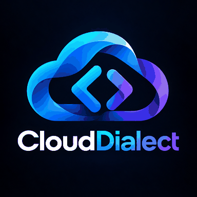

# CloudDialect

**Community-accessible, source-available cloud framework project with paid licensing for commercial products.**

## Project status

**Foundation stage:** The repository contains branding, licensing and governance documents, but **does not yet contain a functioning cloud framework**. There are no production-readiness, support, compatibility or security guarantees.

## Licensing

Copyright © 2026 **Vincent Chu Wai Chow**.

CloudDialect is **source-available, not OSI-approved open source**. CloudDialect Community License 1.0 is operative for materials expressly distributed under it. See [LICENSE.md](LICENSE.md).

| Use case | Licensing requirement |
|---|---|
| Personal education, research and noncommercial experimentation | Community license, free |
| Non-revenue-generating community projects and permitted redistribution | Community license, free, with notices |
| Isolated internal evaluation, including by businesses | Community license, free |
| Paid SaaS, apps, APIs, ads-supported, freemium or other revenue-generating offerings built or operated using CloudDialect | **Separate paid commercial license required before commercial use** |
| White-label resale, OEM distribution, hosted resale | **Separate paid commercial license plus mandatory attribution** |

Commercial licensing is required for products intended to generate revenue even if they have not yet earned revenue. Attribution alone, donations or an unaccepted invoice do **not** confer commercial rights. Commercial permissions and financial terms arise only from a separately executed agreement.

**A business's existence or unrelated revenue does not by itself prohibit unrelated, genuinely noncommercial use.** The precise definitions and restrictions are in [LICENSE.md](LICENSE.md), which prevails over this summary for community permissions.

## Commercial licensing

See [COMMERCIAL-LICENSING.md](COMMERCIAL-LICENSING.md) and the [Commercial Agreement Template](COMMERCIAL-AGREEMENT-TEMPLATE.md). To initiate an inquiry, [open a GitHub issue](https://github.com/VincentChuWaiChow/CloudDialect/issues/new) with **non-confidential information only**. Issues are public. A private discussion may be arranged separately. **No private contact email is published.**

## Contributors

Issues, bug reports and design proposals are welcome. Copyrighted code and documentation submissions require a separately signed [Contributor License Agreement](CONTRIBUTOR-LICENSE-AGREEMENT.md) and verification by the maintainer **before merge**; opening a pull request alone does not supply the needed commercial sublicensing rights. Read [CONTRIBUTING.md](CONTRIBUTING.md).

## Project and legal documents

- [LICENSE.md](LICENSE.md) — Community License 1.0
- [NOTICE](NOTICE) — ownership and attribution
- [ATTRIBUTION.md](ATTRIBUTION.md) — notice and commercial attribution guidance
- [COMMERCIAL-LICENSING.md](COMMERCIAL-LICENSING.md) — scope and commercial inquiry process
- [COMMERCIAL-AGREEMENT-TEMPLATE.md](COMMERCIAL-AGREEMENT-TEMPLATE.md) — agreement form requiring execution
- [CONTRIBUTOR-LICENSE-AGREEMENT.md](CONTRIBUTOR-LICENSE-AGREEMENT.md) — agreement form requiring signature
- [THIRD-PARTY-NOTICES.md](THIRD-PARTY-NOTICES.md) — third-party rights records
- [BRAND.md](BRAND.md) — brand and logo guidance
- [MAINTAINER-CHECKLIST.md](MAINTAINER-CHECKLIST.md) — ongoing compliance and release checks

## Rights notice

No trademark registration, exclusive right to the name, or approval of the custom license by any court or lawyer is claimed here. Licensed grants do not override mandatory legal exceptions or the rights of third-party owners.
